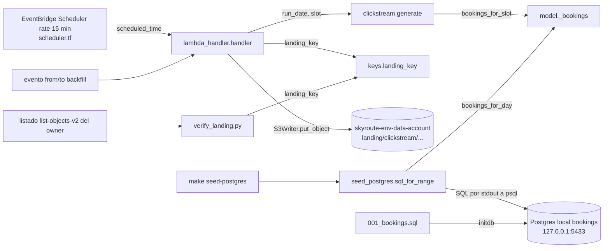
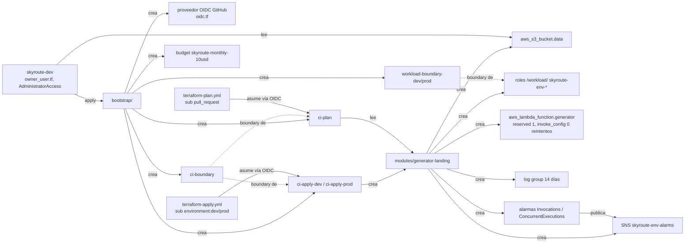

# Research — Fase 3: Bronze y Silver con Spark + Iceberg

## Header

- **Tarea:** documentar lo que existe hoy en el repo y que la Fase 3 (README § Fases: "Jobs PySpark con tests, MERGE, sesionización, SCD2, conversión de divisas. Hecho cuando relanzar un día da exactamente el mismo resultado") va a consumir o tocar.
- **Fecha:** 2026-11-14; correcciones de review 2026-11-19.
- **Rama de referencia:** el código se describe en `origin/main` en 5667495 (merge de la PR #20); `docs/design/` se describe en la rama `docs/bronze-silver-research`, que no incluye la PR #20. Para `lambda.tf` valen los hechos de `origin/main` (C4); las líneas de `lambda.tf` que no son 41-51 se citan del checkout y pueden desplazarse en `main`.
- **Alcance:** `generators/`, `docker/postgres/`, `Makefile`, `infra/terraform/{bootstrap,modules/generator-landing,envs/dev,envs/prod}`, `.github/workflows/`, y como cruce los docs `docs/design/README.md`, `docs/design/platform-blueprint/current/project/README.md` y `docs/design/generator-landing/context.md`. Restricciones: Conventions Table format, Medallion layers, Compute split, Region, No hourly-billed resources, IaC only, Apply gate e Idempotency (`docs/design/CONTEXT.md` § Conventions).
- **Review:** 1 ronda (adversarial-reviewer GO-WITH-FIXES, security-reviewer, cost-guard), hallazgos aplicados 2026-11-19.
- **Behavior Contract:** solo lo que existe hoy; sin sugerencias, root cause ni trabajo futuro; rutas y líneas concretas; código vivo antes que docs.

## Summary

Hoy no existe código Spark, dbt, Airflow ni ningún recurso Glue o Athena: `Grep` de `glue|athena|iceberg` en `infra/` no da resultados. Existen cinco componentes que la Fase 3 consumirá o tocará: (1) el generador de clickstream que escribe JSON lines gzip en `landing/clickstream/ingest_date=…/slot=…/part.json.gz`; (2) las Reservas en Postgres local sembradas por `make seed-postgres` desde el mismo modelo; (3) el módulo Terraform `generator-landing` con un bucket por entorno y lifecycle de 30 días sobre `landing/`; (4) la capa IAM de `bootstrap/` (roles de CI, boundaries de workload, usuario del owner, OIDC, budget), cuya ci-boundary da servicios S3, Lambda, Scheduler, Logs, SNS y CloudWatch sobre ARN concretos más IAM de workload y `PassRole`, sin Glue ni Athena; (5) el tooling de tests (pytest del generador vía `make`) y dos workflows de CI solo de Terraform. Clickstream y Reservas comparten la misma fuente (`ota.model._bookings`) y los mismos ids; difieren en que el clickstream depende de `(run_date, slot)` y Postgres solo de `run_date`, y en que Postgres no guarda historial de estados. En la navegación cada evento tiene su propia sesión y su propio cliente aleatorio, así que hoy no hay sesiones de varios eventos ni recorridos que acaben en compra. Las fuentes de tipos de cambio, gasto publicitario y CRM no existen.

## Findings por componente

### C1. Contrato de landing/ (clickstream)

**Archivos:** `generators/ota/clickstream.py` (80 líneas), `generators/ota/keys.py` (51), `generators/ota/model.py` (96), `generators/lambda_handler.py` (105), `generators/verify_landing.py` (70).

- **Formato:** JSON lines, una línea por evento, `json.dumps(sort_keys=True, separators=(",", ":"))`, UTF-8, comprimido con gzip nivel 6 y `mtime=0` (`clickstream.py:77-80`). Un objeto por `(run_date, slot)`; `S3Writer` lo sube con `ContentType="application/gzip"` (`lambda_handler.py:61-64`).
- **Clave S3:** `landing/clickstream/ingest_date=YYYY-MM-DD/slot=NN/part.json.gz`, con `slot` de `00` a `95` (`keys.py:8-9`, `keys.py:47-51`). La misma función la usa `verify_landing.py:16,28`.
- **Tiempo lógico:** el evento programado trae `scheduled_time`, que se redondea hacia abajo a 15 min en UTC para dar `(run_date, slot)` (`lambda_handler.py:22-36`, `99-102`). El backfill recorre `from..to` y 96 slots por día, y rechaza `to > hoy-1` (`lambda_handler.py:75-91`); esa es la única lectura de reloj (`lambda_handler.py:6-7`, `48-49`). El schedule es `rate(15 minutes)`, `ENABLED` solo si `schedule_enabled` (`modules/generator-landing/scheduler.tf:4-5`), con 2 reintentos y 900 s de edad máxima (`scheduler.tf:21-24`).
- **Determinismo:** semilla `sha256(f"{run_date}|{slot}|{source}")` (`keys.py:12-15`); ids estables por hash (`keys.py:30-39`). Redelivery = misma clave, mismos bytes (test `test_handler.py:75`).
- **Esquema del evento** (`clickstream.py:43-55`, `59-70`):

  | Campo | Tipo en el JSON | Presente en |
  |-------|-----------------|-------------|
  | `event_id` | string `E`+20 hex | todos |
  | `event_type` | `page_view`, `search`, `add_to_cart`, `consent` (pesos 60/25/10/5, `model.py:35-36`) o `purchase` | todos |
  | `event_ts` | string `YYYY-MM-DDTHH:MM:SSZ` (`model.py:43-44`) | todos |
  | `customer_id` | `C`+6 dígitos, pool 20.000 (`keys.py:22-23`, `model.py:20`) | todos |
  | `session_id` | `S`+16 hex | todos |
  | `campaign_id` | `CMP-0001`..`CMP-0008` | todos |
  | `currency` | `EUR`/`GBP`/`USD`/`CHF`, fija por cliente (`model.py:33`, `47-48`) | todos |
  | `amount` | float con 2 decimales o `null` | número solo en `add_to_cart` y `purchase` |
  | `consent_ts` | string timestamp fijo por cliente (2025-01-01 + n%365 días, `model.py:55-56`) | todos |
  | `email` | `u<12 hex>@example.com` (`keys.py:42-44`) | solo `consent` |
  | `booking_id` | `BYYYYMMDDjjjj` (`keys.py:30-31`) | solo `purchase` |

- **Sesiones y clientes:** cada evento de navegación recibe `session_id(run_date, slot, i)` con su propio índice `i` (`clickstream.py:48`), es decir, una sesión por evento, y un `customer_n` sorteado por evento (`clickstream.py:33`). El `purchase` lleva el `session_id` de la reserva, `session_id(run_date, slot, 1000 + j)` (`model.py:78`, `clickstream.py:64`), que nunca coincide con el de un evento de navegación (`i` < 45). Hoy no hay sesiones de más de un evento ni recorridos de un cliente que acaben en compra.
- **Volumen:** 25-45 eventos de navegación por slot (`clickstream.py:31`) más los `purchase` de las reservas de ese slot (120 reservas/día, `model.py:21`), más duplicados. Dato real del owner, 2026-11-14 en prod: 96 objetos y 178.007 bytes en `landing/clickstream/ingest_date=2026-11-14/` (`aws s3 ls … --recursive --summarize`); del orden de 5,3 MB en la ventana de 30 días.
- **Duplicados:** con probabilidad 0,03 por evento, copia exacta (`dict(e)`, mismo `event_id`) añadida al final del mismo archivo (`clickstream.py:17`, `72-74`). Los duplicados no cruzan archivos.
- **Tardíos:** con probabilidad 0,05 (`clickstream.py:16`, `36`), `event_ts` es ANTERIOR a su slot de llegada en 1 s–72 h (`clickstream.py:15`, `37`, `41`: `ts -= timedelta(seconds=late_shift)`); el evento se escribe en el slot de llegada, no en el de `event_ts`. Los `purchase` nunca son tardíos: `event_ts = created_at` de la reserva (`clickstream.py:62`).
- **Campos de tiempo:** solo `event_ts` y `consent_ts`. El evento no lleva `updated_at` ni hora de ingesta; la fecha de llegada solo está en la clave (`ingest_date`, `slot`).
- **PII sintética:** el `email` (`keys.py:42-44`, `u…@example.com`) se escribe en claro en el objeto, protegido solo por SSE-S3 (`bucket.tf:21-29`; sin KMS, `bucket.tf:15`; sin access logging, `bucket.tf:17`; sin versioning, `bucket.tf:14`); la única caducidad es el lifecycle. `consent_ts` y `customer_id` van en todos los eventos. El handler no registra contenido de eventos: por slot escribe `run_date`, `slot`, `key` y `bytes` (`lambda_handler.py:71`), y en el backfill `from`, `to` y `objects` (`lambda_handler.py:82,90`).
- **Consumidores hoy:** `verify_landing.py` (compara un listado `list-objects-v2` con las claves esperadas de D-182..D-1, `verify_landing.py:18-45`) y los tests. Ningún lector de datos.
- **Edge cases:** el esquema varía por `event_type` (campos opcionales `email`, `booking_id`; `amount` nulo). El `purchase` se emite para toda reserva, sea cual sea su `status` (`clickstream.py:58-70`; `model.py:34`). No hay "campos nuevos" en el tiempo: el conjunto de campos es fijo en el código.

### C2. Reservas en Postgres local

**Archivos:** `docker/postgres/init/001_bookings.sql` (11), `docker/postgres/compose.yml` (22), `generators/ota/seed_postgres.py` (74), `generators/ota/model.py` (96), `Makefile` (14).

- **Esquema:** tabla `bookings` con `booking_id text PRIMARY KEY`, `customer_id`, `session_id`, `campaign_id`, `status`, `currency` (text NOT NULL), `amount numeric(10,2)`, `created_at timestamptz`, `updated_at timestamptz` (`001_bookings.sql:1-11`). Sin tabla de historial ni de clientes.
- **Origen de las filas:** `model._bookings(run_date)` genera 120 reservas por día con semilla por `(run_date, j, "booking")` (`model.py:59-88`). `seed_postgres.rows_for_day` proyecta 9 columnas (`seed_postgres.py:15-22`); `route` y `slot` existen en el modelo (`model.py:83-84`) pero no en la tabla.
- **Coherencia con el clickstream:** cada reserva produce un `purchase` con el mismo `booking_id`, `customer_id`, `session_id`, `campaign_id`, `currency` y `amount` (`clickstream.py:58-70`); test `test_keys.py:38` (`test_ts_u3_purchase_booking_ids_exist_in_rows`).
- **Divisas:** `EUR` (3/6), `GBP`, `USD`, `CHF` por `customer_n % 6` (`model.py:33`, `47-48`).
- **Estados y `updated_at`:** `status` se elige una vez entre `confirmed` (3/5), `pending`, `cancelled` (`model.py:34`, `70`). `updated_at = created_at` si `confirmed`; si no, `created_at + 1..600 min` (`model.py:72-74`), que puede caer en el día siguiente. Es un valor fijado en la generación, no una llegada tardía: la fila se inserta una sola vez con ese `updated_at`. No hay transiciones de estado: cada reserva tiene una sola versión.
- **Siembra:** `make seed-postgres` (`Makefile:13-14`) ejecuta `python3 -m ota.seed_postgres --from $(SEED_FROM) --to $(SEED_TO)` (`SEED_FROM` y `SEED_TO` valen los dos `2026-01-01`, `Makefile:4-5`, así que la siembra por defecto es un solo día) y lo pasa por tubería a `psql` dentro del contenedor con `docker compose exec` (`Makefile:3`, `14`). Ningún target del Makefile ejecuta `docker compose up`. El SQL va en una transacción con `INSERT … ON CONFLICT (booking_id) DO NOTHING` (`seed_postgres.py:31-51`): re-sembrar no modifica filas existentes.
- **Contenedor:** `postgres:18.7`, puerto `127.0.0.1:5433`, volumen `pgdata`, init montado en `/docker-entrypoint-initdb.d` (`compose.yml:5-14`); contraseña desde `../../.env` con `env_file … required: false` (`compose.yml:7-9`), puerto en `127.0.0.1:5433` (`compose.yml:11`); `make env` copia `.env.example` (`Makefile:10-11`). `.env.example` existe y está versionado (`git ls-files .env.example`, un solo commit, 9e4191b); su contenido no se leyó (los agentes tienen denegada la lectura de `.env*`). No hay archivos `.tfvars` versionados; existe `infra/terraform/bootstrap/terraform.tfvars.example`.
- **Consumidores:** ninguno salvo `psql` y los tests. No hay export a `landing/` (Ruling de `generator-landing`, `generator-landing/context.md:15`).

### C3. Fuentes que no existen

No hay código, ruta de `landing/` ni tabla para gasto publicitario, CRM emailing ni tipos de cambio: `keys.py` solo define `CLICKSTREAM_PREFIX` (`keys.py:9`) y el alcance de la Fase 2 las excluye (`generator-landing/context.md:32`, OQ8). El blueprint las describe así (`platform-blueprint/current/project/README.md:29-31`): gasto publicitario "CSV diario por plataforma (Google Ads, Meta, Criteo)", "esquemas distintos, correcciones retroactivas"; CRM "JSON diario", "bajas de consentimiento a propagar"; tipos de cambio "API BCE, diario", "días sin publicación: arrastrar el último valor".

### C4. Infra existente

**Archivos:** `infra/terraform/modules/generator-landing/{bucket,iam,lambda,scheduler,alarm,outputs,variables,versions}.tf`, `infra/terraform/envs/{dev,prod}/main.tf` (7 cada uno), `infra/terraform/bootstrap/{ci_roles,ci_apply_dev,ci_apply_prod,workload_boundary_dev,workload_boundary_prod,lambda_quota,budget,oidc,state_bucket,owner_user,account_public_access_block,backend,variables,versions}.tf`.

- **Bucket:** uno por entorno, `skyroute-<env>-data-<account_id>` (`bucket.tf:3-8`), `force_destroy = false` (`bucket.tf:12`), SSE-S3 (`bucket.tf:21-29`), bloqueo público, `BucketOwnerEnforced`, política con un único statement `DenyInsecureTransport` (`bucket.tf:48-73`, Sid en `55-67`), sin versioning (`bucket.tf:14`). Lifecycle: expira `landing/` a 30 días y aborta multipart a 7 (`bucket.tf:76-102`); no hay regla de expiración para ningún otro prefijo. La expiración cuenta desde la creación del objeto, no desde `ingest_date` (`bucket.tf:79-90`).
- **Lambda (en `origin/main`):** `resource "aws_lambda_function" "generator"` (`lambda.tf:43`), precedido del comentario "Concurrencia reservada restaurada a 1 (PR-Q, Fase 11)…" (`lambda.tf:41-42`); `timeout = var.backfill_timeout` (`lambda.tf:49`), con default 60 (`variables.tf:33-37`) que `envs/prod/main.tf` no sobrescribe; `reserved_concurrent_executions = 1` (`lambda.tf:51`); ya no hay skip de CKV_AWS_115. El owner comprobó en prod (2026-11-14 y 2026-11-19) `ReservedConcurrentExecutions: 1` con `aws lambda get-function-concurrency`. En el mismo archivo: log group con `retention_in_days = 14` y `aws_lambda_function_event_invoke_config` con `maximum_retry_attempts = 0` (`lambda.tf:24` y `63-66` en el checkout; el segundo queda desplazado en `origin/main`), con `maximum_event_age_in_seconds = 900`. `bootstrap/lambda_quota.tf:8-12` pide subir la cuota de concurrencia de Lambda a 1000.
- **Alarmas:** topic SNS `skyroute-<env>-alarms` con política que solo deja publicar a CloudWatch de la cuenta y suscripción email (`alarm.tf:1-37`); alarma de `Invocations` > `var.alarm_threshold` en 1 h (`alarm.tf:39-56`) y de `ConcurrentExecutions` > `var.concurrency_alarm_threshold` en 5 min (`alarm.tf:62-79`). Ambas alarmas y el topic existen aunque la carga sea mínima.
- **`versions.tf` del módulo:** Terraform `>= 1.11.0`, `hashicorp/aws ~> 6.73`, `hashicorp/archive ~> 2.7` (`modules/generator-landing/versions.tf:1-14`).
- **Budget:** `skyroute-monthly-10usd`, 10 USD al mes, `include_credit = false` (`budget.tf:1-11`), alertas `ACTUAL` al 50, 80 y 100 % (`budget.tf:13-35`): miden el gasto bruto, sin restar créditos.
- **Cuenta y owner:** bloqueo de acceso público a nivel de cuenta (`account_public_access_block.tf:5,7`). Usuario `skyroute-dev` en el grupo `admins` con `AdministratorAccess` (`owner_user.tf:25-45`, skip CKV_AWS_274 en `37`); el comentario dice consola + MFA y sin access keys (`owner_user.tf:3`). Es la única identidad que hoy puede leer objetos de `landing/`. `state_bucket.tf` y `oidc.tf` crean el bucket de state y el proveedor OIDC de GitHub.
- **OIDC:** los `sub` son exactos, sin comodines: `pull_request` para ci-plan (`ci_roles.tf:383`), `environment:dev` (`ci_apply_dev.tf:22`) y `environment:prod` (`ci_apply_prod.tf:22`), con `aud = sts.amazonaws.com`. Output `bucket_name` (`outputs.tf:1-4`). dev: `schedule_enabled = false`; prod: `true` (`envs/dev/main.tf:5`, `envs/prod/main.tf:5`).
- **Glue/Athena:** no hay recurso `aws_glue_*` ni `aws_athena_*`; ninguna base `skyroute_{bronze,silver,gold,ops}` en el código. Sin workgroup propio, dbt sobre Athena usaría `primary`, que no tiene límite de escaneo definido en el código (su estado en la cuenta no está comprobado).
- **Precios de referencia** (consultados por cost-guard el 2026-11-19, sin confirmar para eu-west-3): Glue 0,44 USD/DPU-hora estándar y 0,29 USD/DPU-hora Flex (https://aws.amazon.com/glue/pricing/); Athena 5 USD/TB escaneado (https://aws.amazon.com/athena/pricing/).
- **Roles de workload:** path `/workload/`, nombre `skyroute-<env>-*`, boundary `workload-boundary-<env>`, solo inline policies (`modules/generator-landing/iam.tf:1-16`). `generator-exec` solo tiene `s3:PutObject` en `landing/*` y logs (`iam.tf:35-56`).
- **Boundary de workload:** `workload-boundary-dev` permite solo `s3:PutObject` en `<bucket>/landing/*`, logs del generador e invocar la Lambda, y deniega el bucket de state (`workload_boundary_dev.tf:3-35`). No permite `s3:GetObject`, `s3:ListBucket`, Glue ni Athena.
- **ci-boundary:** `AllowWorkloadServices` da `s3:*`, `lambda:*`, `scheduler:*`, `logs:*`, `sns:*`, `cloudwatch:*` sobre los ARN fijos de `env_arns` (`ci_roles.tf:207-226`, `16-27`); además permite IAM sobre roles de workload (`AllowWorkloadIam`, `ci_roles.tf:234`) y `PassRole` a servicios de workload (`AllowPassRoleToWorkloadServices`, `ci_roles.tf:245`), y deniega la lectura de logs (`DenyLogRead`, `ci_roles.tf:355`; repetido en ci-plan, `ci_roles.tf:517`). El ARN de S3 permitido es solo el del bucket (`ci_roles.tf:211`, `218`), no `<bucket>/*`: ningún rol de CI puede leer ni escribir objetos. Sin `glue:*` ni `athena:*`.
- **ci-apply-dev/prod:** inline con listas enumeradas por servicio (`ci_apply_dev.tf:60-118`; listas en `ci_roles.tf:79-170`). `iam:PassRole` solo a `lambda.amazonaws.com` y `scheduler.amazonaws.com` (`ci_roles.tf:63`), con Deny para otros servicios (`DenyPassRoleWrongService`, `ci_apply_dev.tf:160`). El Deny efectivo de escrituras IAM fuera de workload es `DenyRoleWritesOutsideWorkload` con `NotResource` (`ci_apply_dev.tf:154`, `ci_roles.tf:279`); `ci_roles.tf:66-74` es la lista `role_write_actions`. `AttachRolePolicy` denegado (`ci_apply_dev.tf:207`). ci-apply-dev tiene además `DenyAttachCrossEnvBoundary` (`ci_apply_dev.tf:143-152`) y `ListBucket` del state limitado a `s3:prefix=envs/dev/` (`ci_apply_dev.tf:38-47`).
- **ci-plan:** lectura de metadatos de S3, Lambda, Scheduler, IAM, logs, SNS, CloudWatch, `DenyDataObjectRead` (`s3:GetObject` en `skyroute-*-data-*/*`, `ci_roles.tf:511`) y `DenyLogRead` (`ci_roles.tf:517`) (`ci_roles.tf:393-600`). Solo lee. Sin lectura Glue ni Athena.
- **Simetría dev/prod:** las boundaries son iguales salvo `env_arns` (`workload_boundary_prod.tf:9-34` frente a la de dev), los Sids de `ci_apply_{dev,prod}.tf` coinciden y `envs/{dev,prod}/main.tf` solo difieren en `env` y `schedule_enabled`.
- **Glue jobs:** ninguno.

### C5. Tooling, tests y CI

- **Tests:** `make test-generators` ejecuta `pytest generators/tests -q` (`Makefile:7-8`). Cinco archivos: `test_determinism.py`, `test_handler.py`, `test_keys.py`, `test_package.py`, `test_verify_landing.py` (23 funciones `test_*`). Importan con `sys.path.insert` a `generators/` (`test_keys.py:7`). No hay `pyproject.toml`, `requirements*.txt`, `pytest.ini` ni `conftest.py` (Glob sin resultados).
- **Runtime:** Lambda `python3.13`, handler `lambda_handler.handler`, zip de `generators/` (`lambda.tf:9`; `runtime` y `handler` en `lambda.tf:35-36` del checkout, dentro del recurso que en `origin/main` empieza en `lambda.tf:43`).
- **AGENTS.md § Comandos de build y test:** solo los comandos de Terraform (`fmt`, `validate`, `tflint`; checkov solo en CI); lint Python, tests Spark y dbt siguen como `TODO`.
- **CI:** `terraform-plan.yml` en `pull_request` con matriz `dev`/`prod` (fmt, init, validate, plan `-lock=false`, comentario en la PR; `terraform-plan.yml:16-110`) y `static-checks` (checkov sobre `infra/terraform`, Python 3.12, y tflint en `envs/dev` y `envs/prod`; `terraform-plan.yml:112-147`). `terraform-apply.yml` en `push`, jobs `apply-dev` (environment `dev`) y `apply-prod` (environment `prod`) (`terraform-apply.yml:3-4`, `18-22`, `55-60`); `apply-prod` tiene `needs: apply-dev` (`terraform-apply.yml:57`) y la concurrencia es global, `group: terraform-apply` (`terraform-apply.yml:9-11`). Ningún workflow ejecuta pytest. Simetría dev/prod de IAM y envs: ver C4.
- **Ejecución local:** `pytest generators/tests` no ejecutado en esta research (falta pytest en el python3.15 local).

### C6. Decisiones abiertas del README de diseño que tocan la fase

Estado `Proposed` en `docs/design/README.md`:

- Dónde corre Spark en las ejecuciones diarias: local en Docker / Glue 5 para todo / local + Glue solo en demos (`README.md:55`).
- Motor de checks en la rama WAP de Silver: PySpark propio / Soda Core (`README.md:56`).
- Modo de escritura Iceberg por tabla: CoW / MoR (el blueprint sugiere MoR en Silver bookings) (`README.md:57`).
- Paso a plan Paid antes del vencimiento del Free el 2027-01-22 (`README.md:59`); la decisión de cuenta Free está tomada (`README.md:54`).
- Credenciales de AWS para lo que corre en local (Airflow, Spark, export de Postgres a `landing/`): tercer rol OIDC / identidad con MFA / todo en AWS (`README.md:60`).

## Merge points y consumidores

- `ota.model._bookings` (`model.py:59-88`) es el punto común: lo leen `clickstream.build_events` vía `bookings_for_slot` (`clickstream.py:58`) y `seed_postgres.rows_for_day` vía `bookings_for_day` (`seed_postgres.py:21-22`).
- `ota.keys.landing_key` (`keys.py:47-51`) lo usan `lambda_handler._write_slot` (`lambda_handler.py:69`) y `verify_landing.expected_keys` (`verify_landing.py:28`).
- `local.env_arns` (`ci_roles.tf:16-27`) lo comparten `ci-boundary`, `ci-plan`, `ci-apply-{dev,prod}` y `workload-boundary-{dev,prod}`.
- El nombre del bucket se calcula dos veces de forma independiente: `bucket.tf:7` (módulo) y `ci_roles.tf:18` (bootstrap).

## Diagramas

## Tabla comparativa

| Concepto | Clickstream (`landing/`) | Reservas (Postgres) |
|----------|--------------------------|---------------------|
| Clave de generación | `(run_date, slot)` | `run_date` (y `j`) |
| Formato | JSON lines gzip en S3 | filas SQL, `timestamptz` y `numeric(10,2)` |
| Timestamps | string ISO `Z` | `timestamptz` |
| Campo de tiempo de cambio | ninguno (`event_ts`, `consent_ts`) | `updated_at` |
| Duplicados | 3 % copias exactas en el mismo archivo | imposibles (PK + `ON CONFLICT DO NOTHING`) |
| Sesiones | una sesión por evento de navegación; la del `purchase` no coincide con ninguna | `session_id` de la reserva (`1000 + j`) |
| Tardíos | 5 %, `event_ts` anterior al slot de llegada en 1 s–72 h | no hay llegadas tardías; `updated_at` = `created_at` + 1..600 min fijado al generar |
| Divisa | por cliente, en todos los eventos | por cliente |
| Estados | no aplica | una sola versión por reserva |
| Ubicación | AWS eu-west-3 | Docker local |
| Retención | 30 días desde la creación del objeto, por lifecycle | volumen `pgdata` |
| Volumen real | 96 objetos, 178.007 bytes el 2026-11-14 en prod | 120 filas/día; siembra por defecto de un día |

| Entorno | Bucket | Schedule |
|---------|--------|----------|
| dev | `skyroute-dev-data-<account>` | `DISABLED` |
| prod | `skyroute-prod-data-<account>` | `ENABLED` |

## Inventario

| Archivo | Componente | Rol |
|---------|-----------|-----|
| `generators/ota/clickstream.py` | C1 | genera eventos, duplicados y tardíos |
| `generators/ota/keys.py` | C1, C2 | semillas, ids, clave de landing |
| `generators/ota/model.py` | C1, C2 | catálogos y reservas del día |
| `generators/lambda_handler.py` | C1 | handler, tiempo lógico, escritura S3 |
| `generators/verify_landing.py` | C1 | verificación de claves |
| `generators/ota/seed_postgres.py` | C2 | SQL de siembra |
| `docker/postgres/compose.yml` | C2 | contenedor Postgres |
| `docker/postgres/init/001_bookings.sql` | C2 | DDL `bookings` |
| `Makefile` | C2, C5 | `test-generators`, `env`, `seed-postgres` |
| `generators/tests/*.py` (5) | C5 | tests pytest |
| `infra/terraform/modules/generator-landing/{bucket,iam,lambda,scheduler,outputs,variables}.tf` | C4 | bucket, roles, Lambda, log group, invoke config, schedule |
| `infra/terraform/modules/generator-landing/alarm.tf` | C4 | topic SNS y dos alarmas |
| `infra/terraform/modules/generator-landing/versions.tf` | C4 | versiones de Terraform y proveedores |
| `infra/terraform/envs/{dev,prod}/main.tf` | C4 | instancias del módulo |
| `infra/terraform/bootstrap/ci_roles.tf` | C4 | `env_arns`, ci-boundary, ci-plan |
| `infra/terraform/bootstrap/ci_apply_{dev,prod}.tf` | C4 | roles de apply |
| `infra/terraform/bootstrap/workload_boundary_{dev,prod}.tf` | C4 | boundaries de workload |
| `infra/terraform/bootstrap/{lambda_quota,budget,oidc,state_bucket,owner_user,account_public_access_block}.tf` | C4 | cuota Lambda, budget, OIDC, state, usuario owner, bloqueo público de cuenta |
| `infra/terraform/bootstrap/terraform.tfvars.example` | C4 | ejemplo de variables (no leído) |
| `.env.example` | C2 | plantilla de `.env`, versionada (no leída) |
| `.github/workflows/terraform-{plan,apply}.yml` | C5 | CI de Terraform |
| `docs/design/README.md` | C6 | decisiones abiertas |
| `docs/design/platform-blueprint/current/project/README.md` | C3 | fuentes del blueprint |

## Tensiones y preguntas abiertas

- **T1.** El lifecycle de `landing/` expira por antigüedad del objeto, no por `ingest_date` (`bucket.tf:79-90`). El backfill de 182 días (2026-05-16 a 2026-11-13, `generator-landing/context.md:13`, `50`) se escribió hacia el 2026-11-14, así que todo él caduca a la vez, unos 30 días después (hacia el 2026-12-14; fecha exacta no comprobada). El Ruling los declara regenerables.
- **T2.** El blueprint pide Reservas "incremental por `updated_at`" con "cambios de estado" (`platform-blueprint/.../README.md:28`), pero cada reserva tiene una sola versión y la siembra no actualiza filas (`model.py:70-74`, `seed_postgres.py:36`). Para SCD2 no hay historial que capturar.
- **T3.** No hay export de Postgres a `landing/` (aplazado, `generator-landing/context.md:15`): no consta cómo Spark leería las Reservas.
- **T4.** Ni `workload-boundary-<env>` ni ci-boundary permiten Glue, Athena, `s3:GetObject` en el bucket de datos ni `PassRole` a `glue.amazonaws.com` (`workload_boundary_dev.tf:9-34`, `ci_roles.tf:63`, `207-226`).
- **T5.** El blueprint pide "campos nuevos" en el clickstream (`README.md:27` del blueprint); el esquema del código es fijo.
- **T6.** Volumen: el blueprint fija 50.000-200.000 eventos/día (`README.md:23` del blueprint); el código da del orden de 96 × (25-45) + 120 más 3 % de duplicados, y el dato real del owner es 96 objetos y 178.007 bytes el 2026-11-14 en prod (unos 5,3 MB en la ventana de 30 días).
- **T7.** dev tiene el schedule `DISABLED` (`envs/dev/main.tf:5`); no consta qué entorno lee la Fase 3 ni si dev tiene datos.
- **T8.** Cerrada: `.env.example`, que `make env` copia (`Makefile:11`), existe y está versionado (commit 9e4191b); su contenido no se leyó.
- **T9.** Versiones de Python distintas: Lambda 3.13 (`lambda.tf:35` del checkout), CI 3.12 (`terraform-plan.yml:127`), cachés locales `cpython-315`. No hay dependencias Python declaradas.
- **T10.** El `purchase` se emite también para reservas `pending` o `cancelled` (`clickstream.py:58-70`) y su `event_ts` es `created_at`, no `updated_at`.
- **T11.** Las cinco decisiones de C6 siguen `Proposed` (`README.md:55-57`, `59`, `60`), y la credencial local afecta a la lectura de `landing/` desde Spark local. Hoy la única identidad que puede leer objetos de `landing/` es `skyroute-dev` con `AdministratorAccess` (`owner_user.tf:25-45`): ni los roles de CI (`ci_roles.tf:211,218`, `511`) ni los de workload (`workload_boundary_dev.tf:3-35`) tienen `s3:GetObject`.
- **T12.** Sesionización: el clickstream no tiene sesiones de más de un evento ni recorridos de un cliente que acaben en compra (`clickstream.py:33`, `48`; `model.py:78`).
- **T13.** Dos Conventions se tocan: "Medallion layers" pide `_ingested_at` en Bronze e "Idempotency" exige que relanzar un día dé el mismo resultado (`docs/design/CONTEXT.md` § Conventions). Si `_ingested_at` sale del reloj, relanzar un día cambia ese valor.
- **T14.** No existe workgroup de Athena en el código: dbt usaría `primary`, sin límite de escaneo definido en el código. El budget (`budget.tf:1-35`) mide el gasto bruto sin créditos, y las dos alarmas y el topic SNS (`alarm.tf:39`, `62`) se cobran con carga mínima.

## No comprobado

Los comandos de AWS los ejecuta el owner (Convention Apply gate); ninguno se ejecutó en esta research.

| Punto | Comando |
|-------|---------|
| Tests del generador (falta pytest en el python3.15 local) | `make test-generators` (`pytest generators/tests -q`) |
| Fecha exacta de expiración del backfill | `aws s3api head-object --bucket skyroute-prod-data-<account> --key landing/clickstream/ingest_date=2026-05-16/slot=00/part.json.gz` (campo `Expiration`) |
| Workgroups de Athena en la cuenta y límite de `primary` | `aws athena list-work-groups --region eu-west-3` y `aws athena get-work-group --work-group primary --region eu-west-3` |
| Si hay datos en dev | `aws s3 ls s3://skyroute-dev-data-<account>/landing/ --recursive --summarize` |
| Precio de Glue Flex en eu-west-3 | `aws pricing get-products --service-code AWSGlue --region us-east-1 --filters Type=TERM_MATCH,Field=regionCode,Value=eu-west-3` |
| Gasto acumulado del mes | `aws ce get-cost-and-usage --time-period Start=2026-11-01,End=2026-11-20 --granularity MONTHLY --metrics UnblendedCost` |
| MFA y access keys de `skyroute-dev` | `aws iam list-mfa-devices --user-name skyroute-dev` y `aws iam list-access-keys --user-name skyroute-dev` |
| Cifrado efectivo de los objetos | `aws s3api head-object --bucket skyroute-prod-data-<account> --key <clave>` (campo `ServerSideEncryption`) |
