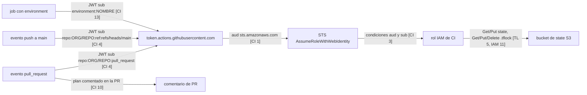
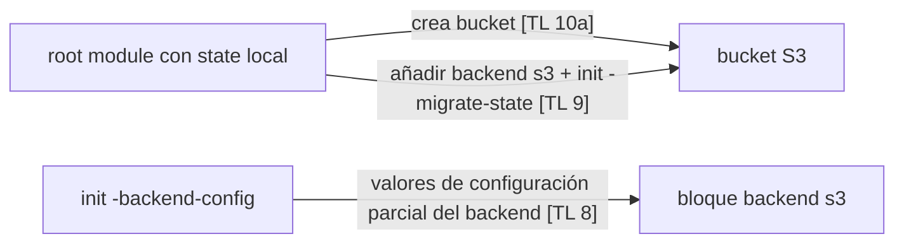
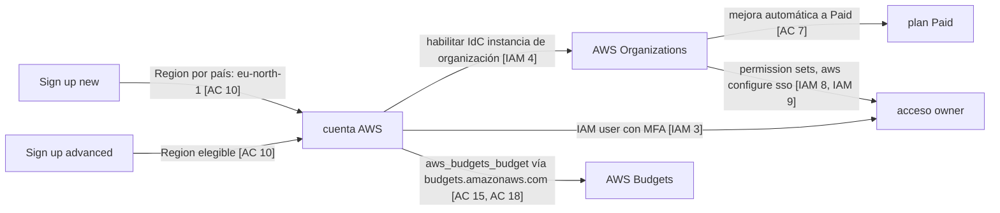

# Research: foundations (Fase 1)

## 1. Header

- **Tarea:** documentar lo que existe hoy para la Fase 1 (cuenta AWS con MFA y usuario no root, presupuesto, bootstrap de Terraform con state remoto y rol OIDC de GitHub, CI básica). Criterio de hecho de la fase (`docs/design/README.md:15`): "Hecho cuando un PR muestra un plan de Terraform y el merge lo aplica."
- **Fecha:** 2026-11-12.
- **Alcance:** consolidación de cuatro notas de área en `docs/design/foundations/working/research/`: `terraform-layout.md`, `cicd-oidc.md`, `iam-security.md`, `account-cost.md`. Estado del repo comprobado con Glob el 2026-11-12. Solo hechos; sin propuestas. La investigación web nueva se limitó a la fase de corrección (ver Estado de la revisión). Ningún comando terraform/AWS (Convention Apply gate).
- **Conventions que acotan el documento** (`docs/design/CONTEXT.md` § Conventions, citadas por nombre): Region, No hourly-billed resources, IaC only, Apply gate, Design write ownership, Subagent roles, Simple shell commands.
- **Convención de citas:** cada hecho remite a su nota (`[TL]` terraform-layout, `[CI]` cicd-oidc, `[IAM]` iam-security, `[AC]` account-cost, con número de hallazgo) y conserva la fuente oficial de la nota, consultada 2026-11-12.
- **Estado de la revisión:** ejecutada (adversarial-reviewer + security-reviewer + cost-guard, una ronda, 2026-11-12); correcciones aplicadas por un único autor, sin segunda ronda. Verificados con WebFetch en la corrección: state en texto plano (§ 3.3) y frecuencia y límites de alertas de Budgets (§ 3.4). El resto de hechos añadidos en la corrección provienen de las fuentes que citaron los revisores y no se releyeron.
- **Datos del owner añadidos 2026-11-12 (F1–F3).** F1: el repo `javiladino/skyroute` se creó el 2026-11-12. F2: el repo es público hoy. F3: la cuenta AWS ya existe y su Region es eu-west-3 (París). Fuente: "dato del owner, 2026-11-12".

## 2. Summary

En el repo no existe ningún componente de la Fase 1: no hay `infra/`, ni archivos `*.tf`, ni `.github/workflows/`; las rutas solo figuran como previstas en `AGENTS.md:23` y `AGENTS.md:31`. Lo que existe son hechos externos documentados en cuatro áreas: layout y backend S3 de Terraform, CI con GitHub Actions y OIDC, IAM y protección del bucket de state, y plan de cuenta, Budgets y precios. Las áreas comparten un mismo eje: el bucket de state (backend `use_lockfile`), cuyos permisos necesita el rol de CI, cuya trust policy depende del formato `sub` del token OIDC, y todo ello en la Region fijada. Difieren en madurez de la fuente: terraform-layout y cicd-oidc citan páginas leídas; iam-security y account-cost contienen varios hechos solo vistos en resúmenes de buscador (ver § No verificado). Hay hechos documentados que chocan con Conventions (Region en el alta nueva, Budgets sin endpoint en eu-west-3, environments según plan de GitHub, creación del bucket de state frente a IaC only) y se registran en § Tensiones con Conventions (las tensiones 1 y 3 quedan resueltas por dato del owner, 2026-11-12).

## 3. Detailed findings per component

### 3.0 Estado del repo

- `Glob {**/*.tf,.github/**,infra/**}` desde la raíz: "No files found" (2026-11-12). Coincide con [TL] Estado del repo, [CI] Estado del repo, [IAM] Estado del repo y [AC] Estado del repo.
- Previsto, no creado: `infra/terraform/{bootstrap,modules,envs/{dev,prod}}/` (`AGENTS.md:23`) y `.github/workflows/` (`AGENTS.md:31`), en la tabla "Previsto (aún no existe; no lo crees sin un plan aprobado)".
- `docs/design/CONTEXT.md:29`: "No hay código, Terraform ni recursos AWS." [AC].
- No hay código vivo con ruta y línea que citar para ningún componente; los hallazgos siguientes son documentación externa.

### 3.1 terraform-layout

Fuente: `docs/design/foundations/working/research/terraform-layout.md` (46 líneas).

- **Layout de módulos.** Root module como único elemento obligatorio; anidados bajo `modules/`, ejemplos bajo `examples/`; la página no da guía para `environments/` ni `envs/` [TL 1] (https://developer.hashicorp.com/terraform/language/modules/develop/structure, consultado 2026-11-12).
- **Backend S3.** Obligatorios `bucket`, `key`, `region` ("AWS Region of the S3 Bucket and DynamoDB Table (if used)") [TL 2]. `use_lockfile` por defecto `false`; con `true` el lock es un objeto `.tflock` junto a la clave [TL 3]. DynamoDB locking "is deprecated and will be removed in a future minor version" [TL 6] (https://developer.hashicorp.com/terraform/language/backend/s3, consultado 2026-11-12).
- **Versiones.** Locking nativo en S3 desde 1.10.0 (2024-11-27), GA en 1.11.0 (2025-02-27) [TL 4]. Terraform CLI v1.17.2 (2026-11-11) "Latest" [TL 11]. Provider `hashicorp/aws` v6.73.0 (2026-11-11), según GitHub releases, no registry [TL 12] (changelogs y releases en GitHub, consultado 2026-11-12).
- **Valores producidos (permisos del backend).** Lock: `s3:GetObject`, `s3:PutObject`, `s3:DeleteObject`; state: `s3:GetObject`, `s3:PutObject`, sin `s3:DeleteObject` [TL 5].
- **Restricciones del bloque backend.** No puede referirse a variables, locals ni data sources [TL 7]; admite configuración parcial con `terraform init -backend-config=...` [TL 8] (https://developer.hashicorp.com/terraform/language/backend y .../cli/commands/init, consultado 2026-11-12).
- **Edge case: chicken-and-egg del bucket.** Cambiar de backend permite migrar el state (`init -migrate-state`, `-force-copy`); `-reconfigure` no migra [TL 9]. La forma documentada de crear el bucket es (a) root module con state local y luego `backend "s3"` + `init -migrate-state`; `-backend-config` en `init` es configuración parcial del backend (pasa valores en `init`, no crea el bucket) [TL 8]; crear el bucket fuera de Terraform es posible pero ninguna página consultada lo describe como bootstrap; no existe un procedimiento oficial de bootstrap en las páginas consultadas [TL 10].
- **Consumidores.** Rol de CI (permisos del backend, § 3.3), workflow de CI (`terraform init/plan/apply`, § 3.2).

### 3.2 cicd-oidc

Fuente: `docs/design/foundations/working/research/cicd-oidc.md` (93 líneas). Repo: `javiladino/skyroute` [CI Header].

- **Proveedor OIDC.** Emisor `https://token.actions.githubusercontent.com`, audiencia `sts.amazonaws.com` con `aws-actions/configure-aws-credentials` [CI 1] (https://docs.github.com/en/actions/how-tos/secure-your-work/security-harden-deployments/oidc-in-aws, consultado 2026-11-12). AWS valida el TLS del JWKS con su almacén de CAs y solo recurre a thumbprints en casos concretos; 1 a 5 thumbprints, 1 a 100 audiencias; proveedor en la misma cuenta que el rol; una URL única por cuenta [CI 2] (https://docs.aws.amazon.com/IAM/latest/UserGuide/id_roles_providers_create_oidc.html, consultado 2026-11-12).
- **Trust policy.** Condiciones `token.actions.githubusercontent.com:aud` y `:sub`; `StringLike` para comodines (`repo:ORG/REPO:*`) [CI 3, CI 6]. `repo:ORG/REPO:*` casa con cualquier rama, `pull_request` y environment del repo (https://docs.github.com/en/actions/how-tos/secure-your-work/security-harden-deployments/oidc-in-aws, consultado 2026-11-12). IAM rechaza crear o actualizar una trust policy de GitHub OIDC si `:sub` falta o es solo comodín/nulo, y avisa de que sin acotar a organización/repo otros repos pueden asumir el rol; la guía de AWS recomienda con fuerza reglas de protección al usar environments con OIDC (https://docs.aws.amazon.com/IAM/latest/UserGuide/id_roles_create_for-idp_oidc.html, consultado 2026-11-12). GitHub aconseja permitir solo los valores esperados de `event_name`; los jobs de Dependabot usan `dynamic` (https://docs.github.com/en/actions/reference/security/oidc, consultado 2026-11-12).
- **Formatos `sub`.** Rama, pull_request, environment, tag [CI 4]; un job con environment emite `sub` de environment, no de rama [CI 13] (https://docs.github.com/en/actions/reference/security/oidc, consultado 2026-11-12). Formato inmutable con IDs numéricos para repos creados después del 15 de julio de 2026 o con opt-in; una trust policy con formato antiguo falla con "Not authorized to perform sts:AssumeRoleWithWebIdentity" [CI 5] (misma fuente y https://github.com/aws-actions/configure-aws-credentials, consultado 2026-11-12). Los renombrados o transferencias posteriores al 2026-07-15 también pasan al formato inmutable; el formato no existe en GitHub Enterprise Server (https://docs.github.com/en/actions/reference/security/oidc, consultado 2026-11-12). Hecho aplicado a este repo: `javiladino/skyroute` se creó el 2026-11-12 (F1, dato del owner, 2026-11-12), posterior al 2026-07-15; por la regla de GitHub citada, su token usa por defecto `repo:OWNER@OWNER-ID/REPO@REPO-ID:...`.
- **Permisos del workflow.** `id-token: write` necesario para pedir el JWT; `contents: read` para checkout [CI 7].
- **Actions.** `aws-actions/configure-aws-credentials` mayor `v6` (ejemplos `@v6.3.0`; GitHub docs usa SHA `e3dd6a42...`) [CI 8]; `hashicorp/setup-terraform@v4` [CI 9]; último tag publicado de ambas no confirmado.
- **Plan en PR / apply en merge.** README de setup-terraform: workflow `pull_request` con fmt, init, validate, plan, comentario vía `actions/github-script@v7`; límite de 65535 caracteres por comentario, alternativa job summary [CI 10] (https://github.com/hashicorp/setup-terraform, consultado 2026-11-12). Tutorial HashiCorp: `terraform-plan.yml` en `pull_request` y `terraform-apply.yml` en `push` a `main`, sobre HCP Terraform, no setup-terraform; plan con `pull-requests: write` [CI 11] (https://developer.hashicorp.com/terraform/tutorials/automation/github-actions, consultado 2026-11-12).
- **Environments.** Hasta 6 revisores, uno basta, "Prevent self-review", reglas de ramas de despliegue. Los environments existen en todos los planes; los revisores requeridos (y los wait timers) solo están disponibles en repos públicos en planes Free, Pro o Team; en repos privados con Pro/Team solo hay reglas de ramas y tags de despliegue (https://docs.github.com/en/actions/reference/workflows-and-actions/deployments-and-environments, consultado 2026-11-12). Si el repo pasa a privado en Free, reglas y secretos se ignoran [CI 12] (https://docs.github.com/en/actions/how-tos/deploy/configure-and-manage-deployments/manage-environments, consultado 2026-11-12).
- **Edge cases.** `pull_request` desde fork: sin secretos, `GITHUB_TOKEN` de solo lectura; Dependabot se trata como fork [CI 14]. `pull_request_target` corre en el contexto de la rama por defecto y la documentación advierte contra ejecutar código de la PR [CI 15]. Emisión de JWT OIDC a PRs de fork: no documentada en las páginas consultadas [CI 16].
- **Consumidores.** Trust policy del rol (§ 3.3), backend (§ 3.1), Apply gate (§ Tensiones).

### 3.3 iam-security

Fuente: `docs/design/foundations/working/research/iam-security.md` (95 líneas).

- **Root.** No usarlo para tareas diarias, sin access keys, usuario administrativo aparte; se prefieren credenciales temporales [IAM 1]. MFA del root exigida en todo tipo de cuenta, registro en 14 días, hasta ocho dispositivos [IAM 2] (https://docs.aws.amazon.com/IAM/latest/UserGuide/root-user-best-practices.html, consultado 2026-11-12).
- **Opción A, IAM user con MFA.** Credenciales de larga duración; no requiere Organizations [IAM 3, IAM 10].
- **Opción B, IAM Identity Center.** Instancia de cuenta: sin permission sets, sin acceso a cuentas AWS, no convertible [IAM 5] (https://docs.aws.amazon.com/singlesignon/latest/userguide/account-instances-identity-center.html, consultado 2026-11-12). Instancia de organización en cuenta standalone: crea una organización con la cuenta como management account; en cuenta de free tier, la pasa a pay-as-you-go y los créditos expiran de inmediato [IAM 4] (https://docs.aws.amazon.com/singlesignon/latest/userguide/enable-identity-center.html, consultado 2026-11-12). Disponible en eu-west-3 (Región por defecto, no opt-in) [IAM 6]. Permission sets: sesión 1 h por defecto, máx. 12 h [IAM 8]. Flujo `aws configure sso` y `~/.aws/config` con `sso_session`, `sso_account_id`, `sso_role_name` [IAM 9] (https://docs.aws.amazon.com/cli/latest/userguide/sso-configure-profile-token.html, consultado 2026-11-12). Elección pendiente del owner [IAM 10].
- **Coste.** IAM y STS sin cargo directo; Identity Center "No additional charge" (solo resumen de buscador); KMS se cobra en instancias de Identity Center multi-Región que usan claves KMS (no las claves KMS multi-Región) [IAM 7].
- **Rol de CI.** Permisos del backend: `s3:ListBucket` en el bucket, Get/Put en el state, Get/Put/Delete en `.tflock`; KMS (`kms:Encrypt`, `kms:Decrypt`, `kms:GenerateDataKey`) si hay `kms_key_id`; HashiCorp recomienda "highly" Bucket Versioning; los permisos para crear recursos del proyecto no se investigaron [IAM 11] (https://developer.hashicorp.com/terraform/language/backend/s3, consultado 2026-11-12). Permissions boundaries como intersección de permisos [IAM 12]; AWS managed / customer managed / inline, `PowerUserAccess` con IAM y Organizations limitados [IAM 13]. Access Analyzer genera políticas desde CloudTrail (hasta 90 días; requiere trail; `iam:PassRole` no aparece) [IAM 14].
- **State en texto plano.** Terraform guarda el state en un archivo en texto plano y los secretos puestos en la configuración quedan en state y plan (https://developer.hashicorp.com/terraform/language/manage-sensitive-data, consultado 2026-11-12).
- **Bucket de state.** SSE-S3 por defecto desde 2023-01-05; SSE-KMS opcional con clave en la misma Región [IAM 15]; clave KMS 1 USD/mes, 20.000 peticiones/mes gratis [IAM 16] (https://aws.amazon.com/kms/pricing/, consultado 2026-11-12). La clave gestionada por el cliente se prorratea por hora y se factura aunque esté inactiva; las dos primeras rotaciones automáticas suman 1 USD/mes cada una (misma fuente). Precio específico de eu-west-3 no verificado. Block Public Access: cuatro ajustes, buckets nuevos sin acceso público [IAM 17]. Versioning deshabilitado por defecto, no vuelve a sin versionar; cada versión se factura [IAM 18]. Deny con `aws:SecureTransport = "false"` [IAM 19]. Object Ownership "Bucket owner enforced" por defecto [IAM 20] (páginas S3 User Guide citadas en la nota, consultado 2026-11-12).
- **Consumidores.** Backend (§ 3.1), trust policy OIDC (§ 3.2), plan de cuenta (§ 3.4: Organizations fuerza Paid).

### 3.4 account-cost

Fuente: `docs/design/foundations/working/research/account-cost.md` (122 líneas). Decisión que informa: `docs/design/README.md:51`, "Plan de cuenta AWS (créditos Free Tier desde julio 2025)", opciones Plan Free / Plan Paid con presupuesto y alertas, estado Proposed. Se documenta, no se decide.

- **Plan Free vs Paid.** 100 USD al alta más hasta 100 USD por actividades, igual en ambos planes [AC 1]; Free termina a los 6 meses o al agotar créditos [AC 2]; al vencer, la cuenta se cierra (docs) o suspende (FAQ), 90 días de retención [AC 3]; mejora a Paid irreversible [AC 4]; Paid da acceso a todos los servicios, pago por uso por lo que supere los créditos, y Free no es elegible para otros créditos promocionales [AC 5]; spend limit desde 20 USD con avisos 50/75/90 % solo en la experiencia nueva [AC 6]; mejora automática a Paid al unirse a Organizations, entre otros [AC 7] (https://docs.aws.amazon.com/awsaccountbilling/latest/aboutv2/free-tier-plans.html y https://aws.amazon.com/free/free-tier-faqs/, consultado 2026-11-12).
- **Experiencia nueva de alta.** Lista (c) de no soportados incluye AWS Organizations, IAM Identity Center, Control Tower, IAM Access Analyzer (salvo validación de políticas); sin funciones multi-Region [AC 9] (https://docs.aws.amazon.com/accounts/latest/reference/supported-services-sign-up-new.html, consultado 2026-11-12). Asigna Region por país de contacto (us-east-2, eu-north-1 con Francia en su lista, ap-southeast-2), no modificable; elegir Region exige "Sign up for AWS (advanced)" o funciones avanzadas [AC 10] (https://docs.aws.amazon.com/accounts/latest/reference/project-regions.html, consultado 2026-11-12). Para la experiencia avanzada no hay lista de servicios por plan [AC 11].
- **AWS Budgets.** Monitorizar y notificar gratis; con acciones, los dos primeros presupuestos con acciones gratis, luego 0,10 USD/día cada uno [AC 13]; un presupuesto de 10 USD con 3 umbrales y sin acciones cuesta 0 USD (https://aws.amazon.com/aws-cost-management/aws-budgets/pricing/, consultado 2026-11-12); avisos ACTUAL y FORECASTED a email y/o SNS [AC 14]. Datos: la nota [AC 14] dice "cada 8 a 12 h"; la página de buenas prácticas dice que los datos de facturación se actualizan "at least once per day". Cada aviso admite hasta 10 emails y un topic SNS; los avisos ACTUAL se envían una vez por presupuesto y periodo; los FORECASTED necesitan ~5 semanas de historial de uso y no se disparan en una cuenta nueva (https://docs.aws.amazon.com/awsaccountbilling/latest/aboutv2/budgets-best-practices.html, consultado 2026-11-12); endpoint `budgets.amazonaws.com` sin fila eu-west-3 [AC 15] (https://docs.aws.amazon.com/general/latest/gr/billing.html, consultado 2026-11-12); el primer presupuesto activa Cost Explorer [AC 16]; Budgets en la lista Free [AC 17].
- **`aws_budgets_budget`.** Requeridos `budget_type`, `time_unit`; bloque `notification` con `comparison_operator`, `notification_type`, `threshold`, `threshold_type` y al menos un suscriptor [AC 18] (fichero del provider en GitHub, `website/docs/r/budgets_budget.html.markdown`, consultado 2026-11-12).
- **Precios eu-west-3.** Glue ETL 0,44 USD/DPU-h, Flex 0,29 [AC 19]; Data Catalog 1 USD por 100.000 objetos, primer millón gratis [AC 20]; Athena 7,00 USD/TB [AC 21]; S3 sin cifra [AC 22] (API de precios de AWS, consultado 2026-11-12).
- **Disponibilidad.** Todos los servicios del blueprint con endpoint regional están en eu-west-3 [AC Tabla de servicios]; Budgets es global. Las dos columnas de la tabla provienen de experiencias de alta distintas: la lista del plan Free es la de la experiencia nueva (que asigna eu-north-1) y no existe lista de servicios para la experiencia avanzada, la única que permite elegir eu-west-3 [AC 9, AC 11].
- **Caducidad de créditos.** El FAQ distingue: los créditos de alta caducan a los 6 meses; los créditos restantes tras pasar a Paid y los créditos por actividades caducan a los 12 meses desde la creación de la cuenta (https://aws.amazon.com/free/free-tier-faqs/, consultado 2026-11-12) [AC 12].

### 3.5 No verificado

Elementos que las notas marcan como `[NO VERIFICADO]`, no verificados o con limitación de fuente (15). Resueltos por dato del owner, 2026-11-12, y retirados de la lista: formato `sub` que emite el repo (F1; ver § 3.2) y visibilidad y plan de GitHub del repo (F2; ver § 4.1, tensión 3).

1. Texto literal de `s3:ListBucket` en la página del backend S3 [TL Estado del repo; IAM 11 lo lista desde un resumen del lector web].
2. Versión del provider según registry.terraform.io [TL 12].
3. Existencia de una guía oficial de bootstrap del bucket de state [TL 10].
4. Último tag publicado de `configure-aws-credentials` y `setup-terraform` [CI 8, CI 9].
5. Emisión de JWT OIDC a PRs de fork [CI 16].
6. Anuncio y blog de MFA del root, y redacción del tutorial de Sign-In ("habilitar MFA manualmente") [IAM 2].
7. Detalles de MFA para IAM users (`id_credentials_mfa.html`) [IAM 3].
8. Endpoint `sso.eu-west-3.amazonaws.com` [IAM 6].
9. Identity Center "No additional charge" (página de precios devolvió 404) [IAM 7].
10. Precio propio de Access Analyzer [IAM 14].
11. Tabla de precios KMS de eu-west-3 [IAM 16].
12. Valores por defecto de Block Public Access en bucket nuevo vía API/Terraform [IAM 17]; clave `s3:TlsVersion` [IAM 19].
13. Argumentos de `aws_budgets_budget` solo desde el fichero de GitHub, valor literal `"COST"` no verificado [AC 18].
14. Precios de S3 en eu-west-3 [AC 22].
15. Endpoints regionales de IAM/STS; enrutado de Budgets por el provider con `region = "eu-west-3"`; `budgets-sns-policy.html`; lista de servicios de la experiencia avanzada [AC Fuentes, "Hechos no verificados"].

## 4. Merge points and consumers

No hay código que combine los componentes; los puntos de unión son hand-offs documentados entre las áreas.

- **Bucket de state ↔ backend.** El bucket que describe [IAM 15-20] es el `bucket` obligatorio del backend [TL 2]; el lock `.tflock` vive en el mismo bucket [TL 3]. El argumento `region` del backend es la Region del bucket [TL 2]; que `.tflock` comparta la Region del bucket es por construcción (mismo bucket), inferencia a partir de [TL 2, TL 3]; la Convention Region incluye el state.
- **Backend ↔ permisos del rol de CI.** Los permisos S3 (y KMS si hay `kms_key_id`) que exige el backend [TL 5, IAM 11] son el mínimo que el rol asumido por CI necesita para `init`/`plan`/`apply`; los permisos de recursos del proyecto no se investigaron [IAM 11].
- **Rol de CI ↔ trust OIDC.** El rol confía en el proveedor `token.actions.githubusercontent.com` de la misma cuenta [CI 1, CI 2]; su condición `sub` debe casar con el formato que emite el job: rama, pull_request o environment [CI 4, CI 13], y con el formato inmutable si aplica [CI 5]. Un `StringLike` con `repo:ORG/REPO:*` casa con cualquier rama, `pull_request` y environment; IAM exige `:sub` no comodín solo/nulo en la trust policy de GitHub OIDC (§ 3.2).
- **Trust OIDC ↔ Apply gate.** El patrón documentado separa plan en `pull_request` y apply en `push` a `main` [CI 11]; cada evento emite un `sub` distinto [CI 4]. Si el job de apply referencia un environment con revisores, emite `sub` de environment [CI 13] y los revisores requeridos dependen del plan y la visibilidad de GitHub [CI 12] (§ 3.2).
- **Budget como primer recurso.** La Convention IaC only fija un `aws_budgets_budget` de 10 USD con alertas 50/80/100 % como primer recurso; su API es global (`budgets.amazonaws.com`) [AC 15], y sus argumentos están en [AC 18]. Inferencia de este documento, no hecho de las notas: dependería de que exista el backend [TL 9, TL 10] (bucket primero) y de un rol con permisos de Budgets (no investigados); ver tensión 7.
- **Plan de cuenta ↔ acceso del owner ↔ Region.** Identity Center con instancia de organización crea una organización [IAM 4], lo que pasa la cuenta a Paid [AC 7] y expira créditos de free tier [IAM 4]; la experiencia nueva no soporta Organizations ni Identity Center [AC 9] y asigna Region sin elegir [AC 10]. La decisión abierta de `docs/design/README.md:51` conecta estas tres áreas.

### 4.1 Tensiones con Conventions

Hechos documentados que chocan con una Convention. Se registran, no se resuelven.

1. **Region vs alta nueva.** La experiencia "Sign up for AWS (new)" asigna Region por país de contacto (Francia → eu-north-1) y no se puede cambiar; eu-west-3 no es asignable [AC 10]. Convention Region: todo recurso en eu-west-3. La experiencia avanzada permite elegir Region [AC 10], pero su lista de servicios por plan no se localizó [AC 11]. **Resuelta por dato del owner (F3, dato del owner, 2026-11-12):** la cuenta AWS ya existe con Region eu-west-3, por lo que el hecho de asignación en el alta nueva no aplica a esta cuenta.
2. **Region vs Budgets.** Budgets no tiene endpoint en eu-west-3 (`budgets.amazonaws.com`) [AC 15]; Convention Region dice "todo recurso AWS"; Convention IaC only fija el budget como primer recurso.
3. **Apply gate vs environments de GitHub.** Los environments existen en todos los planes, pero los revisores requeridos (aprobación manual de prod) solo están disponibles en repos públicos en planes Free, Pro o Team; en repos privados con Pro/Team solo hay reglas de ramas y tags de despliegue (docs de deployments y environments, § 3.2); en Free privado las reglas se ignoran [CI 12]. **Resuelta por dato del owner (F2, dato del owner, 2026-11-12):** el repo es público hoy, y los revisores requeridos están disponibles en repos públicos en Free, Pro o Team, por lo que la condición se cumple mientras el repo siga público; si pasa a privado en Free, los revisores se ignoran [CI 12].
4. **IaC only vs bootstrap del bucket.** "Nada se crea a mano en consola ni por CLI"; el backend no puede referirse a variables [TL 7] y el bucket debe existir antes del `init` con backend S3; las vías documentadas son state local + `-migrate-state` o `-backend-config` [TL 9, TL 10]. Crear el bucket fuera de Terraform no está descrito como bootstrap oficial [TL 10].
5. **Apply gate vs criterio de hecho.** La Convention dice que el owner corre `plan` él mismo y ningún agente ejecuta `plan`; el criterio de Fase 1 (`docs/design/README.md:15`) pide que un PR muestre un plan, y el patrón documentado lo ejecuta CI en `pull_request` [CI 10, CI 11]. Se registra la coexistencia de ambos textos.
6. **No hourly-billed resources vs KMS / Budgets con acciones.** Una clave KMS gestionada por el cliente cuesta 1 USD/mes "prorrateado por hora" [IAM 16]; Budgets con acciones más allá de dos cuesta 0,10 USD/día [AC 13]. Se registra el modo de facturación; no se evalúa si cae bajo la Convention. Un presupuesto sin acciones cuesta 0 USD (§ 3.4).
7. **IaC only vs orden de creación.** La Convention IaC only fija `aws_budgets_budget` como primer recurso; el backend S3 exige que el bucket exista antes del `init` [TL 7, TL 10], de modo que el bucket (o el state local) precedería al presupuesto. Esto último es inferencia de este documento, no un hecho de las notas.

### 4.2 Contradicciones entre notas

- `s3:ListBucket`: [TL 5] dice que el extracto no citó literalmente los permisos de listado; [IAM 11] lo lista, desde un resumen del lector web de la misma página. No es contradicción de contenido, sino de grado de verificación; se mantiene como no verificado (§ 3.5, ítem 1).
- Ninguna otra contradicción directa entre las cuatro notas. Las discrepancias internas de fuente (cierra/suspende [AC 3]; MFA del root obligatoria vs "habilitar manualmente" [IAM 2]) son internas a cada nota.

## 5. Flow diagrams

Cada arista es un hand-off documentado en las notas, no un diseño. No existe código que los implemente.

### 5.1 PR y merge (GitHub Actions → AWS)

### 5.2 Bootstrap del backend

### 5.3 Plan de cuenta y acceso del owner

## 6. Comparison table

| Concepto | Opción / valor documentado | Hecho clave | Fuente (nota) |
|----------|----------------------------|-------------|---------------|
| Acceso del owner | IAM user con MFA | Credenciales de larga duración; sin Organizations | [IAM 3, IAM 10] |
| Acceso del owner | Identity Center, instancia de cuenta | Sin permission sets ni acceso a cuentas AWS | [IAM 5] |
| Acceso del owner | Identity Center, instancia de organización | Crea organización; en free tier pasa a pay-as-you-go y expira créditos; sesiones 1-12 h | [IAM 4, IAM 8] |
| Plan de cuenta | Free | 6 meses o fin de créditos; luego cierre/suspensión con 90 días | [AC 2, AC 3] |
| Plan de cuenta | Paid | Todos los servicios; spend limit desde 20 USD (experiencia nueva); irreversible | [AC 4, AC 5, AC 6] |
| Experiencia de alta | Sign up new | Region asignada (eu-north-1 para Francia); sin Organizations ni Identity Center | [AC 9, AC 10] |
| Experiencia de alta | Sign up advanced | Region elegible; sin lista de servicios por plan localizada | [AC 10, AC 11] |
| `sub` OIDC | `repo:ORG/REPO:ref:refs/heads/RAMA` | Sin environment ni PR | [CI 4] |
| `sub` OIDC | `repo:ORG/REPO:pull_request` | Evento PR sin environment | [CI 4] |
| `sub` OIDC | `repo:ORG/REPO:environment:NOMBRE` | Job con environment | [CI 4, CI 13] |
| `sub` OIDC | `repo:ORG/REPO:ref:refs/tags/TAG` | Tag | [CI 4] |
| `sub` OIDC | `repo:OWNER@ID/REPO@ID:...` (inmutable) | Repos posteriores al 15-07-2026 o con opt-in | [CI 5] |
| Locking del state | `use_lockfile = true` | `.tflock` en S3; desde 1.10, GA 1.11 | [TL 3, TL 4] |
| Locking del state | DynamoDB | Deprecado | [TL 6] |
| Bootstrap bucket | State local + `init -migrate-state` | Documentado por combinación de hechos | [TL 9, TL 10] |
| Configuración del backend | `-backend-config` | Configuración parcial en `init`; pasa valores, no crea el bucket | [TL 8] |
| Bootstrap bucket | Fuera de Terraform | Posible; sin procedimiento oficial | [TL 10] |
| Cifrado del bucket | SSE-S3 | Por defecto, sin coste | [IAM 15] |
| Cifrado del bucket | SSE-KMS (clave cliente) | 1 USD/mes por clave; permisos KMS en el backend | [IAM 11, IAM 16] |
| Revisores requeridos | Free/Pro/Team + repo público | Disponibles (wait timers también) | [CI 12] y docs de deployments |
| Revisores requeridos | Pro/Team + repo privado | No disponibles; solo reglas de ramas y tags de despliegue | docs de deployments (§ 3.2) |
| Environments GitHub | Free + repo privado | Reglas y secretos ignorados | [CI 12] |
| Budgets | Sin acciones | 0 USD (monitorización y avisos gratis) | [AC 13] |
| Budgets | Con acciones | Dos primeros gratis; luego 0,10 USD/día cada uno | [AC 13] |
| Límites de permisos | Permissions boundary | Intersección de permisos | [IAM 12] |
| Límites de permisos | `PowerUserAccess` | IAM y Organizations limitados | [IAM 13] |
| Eventos de fork | `pull_request` de fork | Sin secretos, `GITHUB_TOKEN` solo lectura; Dependabot como fork | [CI 14] |
| Eventos de fork | `pull_request_target` | Contexto de la rama por defecto; advertencia contra ejecutar código de la PR | [CI 15] |
| Eventos de fork | JWT OIDC a PR de fork | No documentado en las páginas consultadas | [CI 16] |
| Plan en PR | setup-terraform + github-script | Comentario, límite 65535 caracteres | [CI 10] |
| Plan en PR | Tutorial HashiCorp | HCP Terraform, `tfc-workflows-github` | [CI 11] |

Nota sobre las filas `sub` OIDC: `javiladino/skyroute` se creó el 2026-11-12 (F1, dato del owner, 2026-11-12), así que su token usa por defecto el formato inmutable (fila `repo:OWNER@ID/REPO@ID:...`; § 3.2). La tabla cubre los conceptos con alternativas documentadas.

## 7. Inventory

| Archivo | Componente | Rol |
|---------|-----------|-----|
| `AGENTS.md:23` | terraform-layout | Ruta prevista `infra/terraform/{bootstrap,modules,envs/{dev,prod}}/`, no creada |
| `AGENTS.md:31` | cicd-oidc | Ruta prevista `.github/workflows/`, no creada |
| `docs/design/CONTEXT.md:29` | todos | Estado: sin código, Terraform ni recursos AWS |
| `docs/design/CONTEXT.md:42-45` | todos | Conventions Region, No hourly-billed resources, IaC only, Apply gate |
| `docs/design/CONTEXT.md:47-48`, `:52` | proceso | Design write ownership, Subagent roles, Simple shell commands |
| `docs/design/README.md:15` | todos | Fase 1 y criterio de hecho |
| `docs/design/README.md:51` | account-cost | Decisión abierta "Plan de cuenta AWS", Proposed |
| `docs/design/platform-blueprint/current/project/README.md:45` | account-cost | Presupuesto dentro de créditos; servicios AWS del blueprint (citado por [AC]) |
| `docs/design/foundations/context.md` | topic | Context del topic; § Rulings: "_Ninguno todavía._" (sin rulings del topic) |
| `docs/design/foundations/working/research/terraform-layout.md` | terraform-layout | Nota de área (46 líneas) |
| `docs/design/foundations/working/research/cicd-oidc.md` | cicd-oidc | Nota de área (93 líneas) |
| `docs/design/foundations/working/research/iam-security.md` | iam-security | Nota de área (95 líneas) |
| `docs/design/foundations/working/research/account-cost.md` | account-cost | Nota de área (122 líneas) |
| `infra/`, `**/*.tf`, `.github/workflows/` | todos | No existen (Glob 2026-11-12) |
