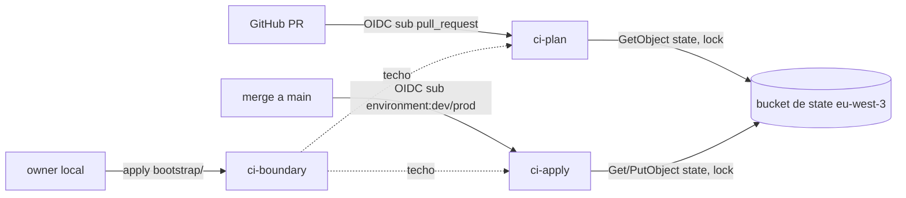

# Research: generator-landing (Fase 2, Generador y landing)

> **Tarea:** documentar lo que existe hoy y los hechos externos para la Fase 2 del lakehouse.
> **Fecha:** 2026-11-13. Toda cifra externa vale solo para su fecha de obtención (2026-11-13 salvo indicación).
> **Alcance:** consolida cinco notas de área de `docs/design/generator-landing/working/research/`: `generator-data.md`, `lambda-eventbridge.md`, `postgres-local.md`, `landing-s3.md`, `ci-permissions.md`. Describe, no propone ni recomienda (contrato de `reppit-research`).
> **Review:** una ronda ejecutada (adversarial: GO-WITH-FIXES; seguridad; coste). Este documento incorpora sus hallazgos como hechos, tensiones y preguntas; no hay segunda ronda (Step 5 de `reppit-research`).
> **Método:** ningún agente ejecutó `terraform` ni comandos AWS (Convention "Apply gate"). Las referencias `file:line` a `infra/terraform/bootstrap/ci_roles.tf` se contrastaron con Grep el 2026-11-13.

## Criterio de hecho de la Fase 2

Literal: "Simulador OTA coherente, Lambda + EventBridge, Postgres local, archivos en `landing/`. Hecho cuando hay 6 meses de histórico y llegan micro-lotes nuevos."

Partes comprobables:

| # | Parte | Qué lo comprobaría |
|---|-------|--------------------|
| C1 | Simulador OTA coherente | Las 5 fuentes comparten identificadores (`customer_id`, `session_id`, `booking_id`, `campaign_id`, `currency`+fecha) y llevan las dificultades inyectadas del blueprint |
| C2 | Lambda + EventBridge | Función Lambda y disparador de EventBridge creados por Terraform en `eu-west-3` |
| C3 | Postgres local | Instancia Postgres en Docker local con la fuente Reservas (incremental por `updated_at`) |
| C4 | Archivos en `landing/` | Objetos de las fuentes bajo el prefijo/capa `landing/` del bucket de datos |
| C5 | 6 meses de histórico | ~182 días de datos generados (dónde deben persistir: ver Tensiones T1). El blueprint dice "~6 meses"; los 182 días son un supuesto de la nota de área `generator-data.md`, no una cifra del blueprint |
| C6 | Llegan micro-lotes nuevos | Archivos de clickstream nuevos cada 15 min en `landing/`, evidenciados por salida de CI o del owner (Convention "Verification ownership") |

## Summary

Hoy no existe ningún componente de la Fase 2: no hay `generators/`, ni bucket de datos, ni Lambda, ni schedule, ni compose de Postgres; `envs/dev` y `envs/prod` solo tienen backend y provider. Lo que sí existe es la base de la Fase 1 en `infra/terraform/bootstrap/`: budget, bucket de state en eu-west-3, proveedor OIDC y los roles `ci-plan`/`ci-apply` bajo la boundary `ci-boundary`, que hoy solo conceden acceso al state. Las cinco áreas comparten tres restricciones: la Convention "Idempotency" (fecha lógica, nunca `now()`), el lifecycle de 30 días de `landing/` frente a 6 meses de histórico, y el Apply gate, que obliga a que toda verificación en AWS venga de CI o del owner. Difieren en dónde corre cada pieza: el clickstream en AWS (Lambda), Reservas en local (Postgres, inalcanzable desde Lambda), y los permisos en `bootstrap/`, que solo aplica el owner. La cuenta sigue en plan Free, con un límite temporal que condiciona el calendario.

## Lo que existe hoy

### Repo

- `infra/terraform/bootstrap/`: `ci_roles.tf` (boundary y roles de CI), `oidc.tf`, `state_bucket.tf`, `owner_user.tf` y el budget (fuente: `ci-permissions.md` H4, `landing-s3.md` H1-H2).
- `infra/terraform/envs/dev` y `envs/prod`: solo backend y provider, sin recursos (`docs/design/foundations/current/plan.md:88`, `:276`, citado en `ci-permissions.md` H2).
- No existen `generators/`, `infra/terraform/modules/`, `airflow/`, `observability/` ni docker-compose ni DDL de Postgres (AGENTS.md § Mapa del repo; `generator-data.md` Alcance; `postgres-local.md` Alcance).
- Workflows: `terraform-plan.yml` (plan en matriz `[dev, prod]`, job `static-checks` con checkov 3.4.5 sobre todo `infra/terraform`, tflint solo en `envs/*`) y `terraform-apply.yml` (jobs `apply-dev`, `apply-prod`); 0 referencias a `bootstrap` (`ci-permissions.md` H4, H9).
- Patrón S3 del repo (`state_bucket.tf`): SSE-S3, versioning, public access block, `BucketOwnerEnforced`, política `DenyInsecureTransport`, lifecycle de noncurrent a 90 días, sin access logging; 4 skips de checkov por recurso (`state_bucket.tf:5-8`) (`landing-s3.md` H2-H3).

### AWS (creado en la Fase 1 por Terraform)

- Budget de 10 USD, bucket de state en eu-west-3, proveedor OIDC, roles `ci-plan` y `ci-apply` (`docs/design/CONTEXT.md` Active Context).
- Ejecución verificada: el plan local de bootstrap del owner no mostró cambios; los runs de CI 43446309534, 43449637195 y 43462639280 (plan/apply, este último con aprobación manual de prod) terminaron con éxito (`docs/design/CONTEXT.md` Active Context).

### Hecho (a): hoy `ci-apply` solo tiene permisos sobre el backend de state

- `ci-boundary` (`ci_roles.tf:12-100`) solo permite `s3:ListBucket` sobre el bucket de state (`:20-24`, Sid `AllowStateBucketList`) y `GetObject`/`PutObject`/`DeleteObject` sobre cuatro ARN exactos de state y lock de `envs/dev` y `envs/prod` (`:25-35`, Sid `AllowStateObjects`). Ningún otro servicio está en su Allow (`ci-permissions.md` H1).
- `ci-apply` (`ci_roles.tf:228-351`) lleva `permissions_boundary = ci-boundary` (`:231`); su política inline `ci-apply-backend` solo concede state y lock (`:263-286`) más los Deny (`:287-348`). No hay permisos sobre recursos de `envs/*` (`ci-permissions.md` H3).
- `ci-plan` (`ci_roles.tf:104-224`) está igual: boundary en `:107`, solo lectura de state y lock (`:136-159`) (`ci-permissions.md` H2).
- Los permisos efectivos son la intersección de identidad y boundary (doc IAM de permissions boundaries, 2026-11-13). Por tanto, todo recurso de Fase 2 (bucket de datos, Lambda, schedule, rol de ejecución, log group) obliga a ampliar a la vez `ci-boundary` y las políticas inline, ambas en `bootstrap/ci_roles.tf`, y eso solo lo aplica el owner en local (`ci-permissions.md` H4).
- El plan de Fase 1 lo dejó pendiente: la boundary "se amplía cuando una fase posterior añada recursos" (`foundations/current/plan.md:276`, citado en `ci-permissions.md` H3).

### Hecho (b): la cuenta sigue en plan Free

- El plan Free dura hasta 6 meses o hasta agotar los créditos (100 USD al abrir más hasta 100 USD por actividades), lo que ocurra antes. Al terminar, la cuenta se cierra y se pierde el acceso a recursos y datos; AWS los retiene 90 días y en ese plazo se puede pasar a pago (docs Free Tier plans y aws.amazon.com/free, 2026-11-13; `lambda-eventbridge.md` H7.1-H7.2).
- La Convention "Bootstrap identity" registra que la cuenta sigue en plan Free.
- El runbook, en "Antes de cerrar la cuenta Free" (`docs/runbooks/foundations-bootstrap.md:70-74`), dice que la cuenta pierde todos sus recursos al terminar, incluido el bucket de state. Documenta la exportación (`terraform state pull > backup.tfstate` en cada root module, guardada fuera de AWS) y, para borrar el bucket de state, el Deny de `s3:DeleteBucket` para Principal `"*"` más `prevent_destroy` (`state_bucket.tf:71-77`, `:10-12`), que hay que quitar antes. El runbook no dice qué pasa con los datos de `landing/`.
- Consecuencia para 6 meses de histórico: el histórico es generado (fechas lógicas pasadas), no esperado en tiempo real; pero si el proyecto necesita que los datos sigan accesibles, la ventana del plan puede cerrarse antes (`lambda-eventbridge.md` T6). La fecha de apertura de la cuenta y el crédito restante no se conocen (Q de owner).
- Consecuencia para un schedule cada 15 min: 96 invocaciones/día por entorno, 5.760/mes con dev y prod, 34.560 en 180 días. Con tarifas de US East caen dentro del nivel gratuito (Scheduler 14 M/mes; Lambda 1 M peticiones y 400.000 GB-s/mes); el escenario hipotético de 512 MB × 30 s usa el 21,6 % de los GB-s. El schedule consume aunque nadie use los datos, y lo que exceda se descuenta de créditos (`lambda-eventbridge.md` H6, H8.1).
- Región de las tarifas: las de Lambda y Scheduler son de US East (https://aws.amazon.com/lambda/pricing/, https://aws.amazon.com/eventbridge/pricing/, obtenidas 2026-11-13). El nivel gratuito no depende de región (Scheduler: "across all Regions"), así que la conclusión de arriba se mantiene; las tarifas de París no están verificadas (V7; comando del owner: `aws pricing get-products --service-code AWSLambda --region us-east-1 --filters Type=TERM_MATCH,Field=regionCode,Value=eu-west-3`).
- Coste del schedule sin consumidor: el schedule corre en dev y prod aunque nadie lea `landing/`; coste ocioso minúsculo pero no nulo.
- Las políticas de spend limit de cuentas Free pueden negar `lambda:CreateFunction`, `scheduler:CreateSchedule` e invocaciones al acercarse al límite; no se sabe si la cuenta tiene spend limit (`lambda-eventbridge.md` H7.6).

### Hecho (c): hechos de Fase 1 sobre el límite de confianza de CI (revisión de seguridad)

Registrados como hechos existentes; no proponen cambio.

- **Verificado, `ci-apply` y el state de prod.** La trust de `ci-apply` acepta `environment:dev` y `environment:prod` (`ci_roles.tf:246-247`) y su política `ci-apply-backend` permite `s3:PutObject` sobre `envs/prod/terraform.tfstate` (Sid `StateReadWrite`, `:270-276`) y sobre el `.tflock` de prod (`:279-285`). Un job en el environment `dev` puede escribir el state de prod. Verificado por el orquestador el 2026-11-13 con `gh api repos/javiladino/skyroute/environments/dev`: `dev` tiene `can_admins_bypass: true` y solo `branch_policy` (sin required reviewers); `prod` tiene required reviewers (`javiladino`, `prevent_self_review: false`) y `can_admins_bypass: false`. La aprobación manual de prod no protege el state de prod frente a un job de `dev`. Tensión T17.
- **Inferido, roles creados por CI y `ci-boundary`.** Todo rol que CI cree debe llevar `ci-boundary` (Deny `ci_roles.tf:55-65`) y esa boundary permite escribir el state de dev y prod (`:25-35`). Los roles de ejecución de Lambda y de Scheduler compartirían el techo de CI, limitados solo por su política inline. Tensión T3.
- **Inferido, huecos de los Deny sobre IAM.** Los Deny no cubren `iam:UpdateAssumeRolePolicy`, `iam:PutRolePolicy`, `iam:AttachRolePolicy` ni `iam:CreatePolicy` sobre roles que no son de CI: `ci_roles.tf:46-54` solo protege `ci-plan`, `ci-apply` y OIDC. Con `CreateRole` y `PutRolePolicy`, CI podría crear un rol con boundary y una trust policy abierta, y obtener acceso persistente fuera de la puerta del environment. Inferido de la lectura de las políticas; no probado (V5, V22). Tensión T18.
- **Inferido, PR y credenciales de `ci-plan`.** Con el trigger `pull_request:` (`terraform-plan.yml:4`) y `id-token: write` (`:22`), el `terraform plan` de una PR ejecuta el código Terraform de la propia PR (data sources `external`/`http`, providers arbitrarios) con las credenciales de `ci-plan`. `ci-plan` lee el state de dev y prod (`ci_roles.tf:143-149`) y escribe el lock (`:152-158`): una PR podría exfiltrar lo que `ci-plan` puede leer o provocar un DoS sobre apply. Verificado: ninguno de los dos workflows usa `pull_request_target`. Tensión T19.
- **Verificado, `iam:PassRole`.** Hoy `iam:PassRole` no aparece en ninguna política (grep). Sin `iam:PassedToService` y sin restricción de nombre o path sería un vector de escalada (V5).
- **Deny duplicados.** Un Deny explícito siempre gana. Los Deny de `ci_roles.tf:36-97` están duplicados en la boundary y en las políticas inline; cualquier ampliación tiene que mantener ambas copias sincronizadas.
- **Patrones S3 de protección que existen solo para el bucket de state:** `DenyDeleteBucket` (`state_bucket.tf:71-77`), `prevent_destroy` (`:10-12`) y `abort_incomplete_multipart` (`:101-103`). `DenyStateBucketProtectionChanges` (`ci_roles.tf:84-97`) cubre solo el bucket de state y no incluye `DeleteBucketPolicy`, `PutEncryptionConfiguration`, `PutBucketOwnershipControls` ni `PutBucketAcl`. No existe nada equivalente para un bucket de datos.
- **TLS en un bucket de datos.** `DenyInsecureTransport` es una política del bucket de state; no se hereda y un bucket de datos tendría que declararla. `bucket_key_enabled` solo aplica con SSE-KMS.
- **Roles de Fase 2 inexistentes.** Ni el rol de ejecución de Lambda ni el rol de Scheduler existen. A revisar contra: para el de Lambda, el scope de escritura a `landing/` (bucket/prefijo) y de logs (`/aws/lambda/<name>`); para el de Scheduler, `lambda:InvokeFunction` sobre una sola función y, si hay DLQ, `sqs:SendMessage` sobre esa cola; para ambos, su trust policy (`lambda.amazonaws.com`, `scheduler.amazonaws.com`) y la `ci-boundary` que llevarían.

### Secretos

- Las variables de entorno de Lambda son visibles mediante `lambda:GetFunctionConfiguration` y quedan en claro en el state de Terraform.
- Las credenciales de Postgres (`POSTGRES_PASSWORD`) no tienen hoy dónde vivir: no existe compose ni `.env` (`postgres-local.md` Alcance).
- Verificado: `.gitignore:6-9` (`*.tfstate`, `*.tfvars`, `!*.tfvars.example`) y `:51-52` (`.env`, `.env.*`); `git ls-files` no rastrea ningún tfvars (salvo `.example`), `.env` ni `.pem`; `infra/terraform/bootstrap/terraform.tfvars` existe en disco, sin rastrear.

### PII

El CRM simulado lleva emails y flags de consentimiento a `landing/`: PII sintética. El blueprint cita "consentimiento RGPD" (`README.md:18`) y "CRM emailing | JSON diario | Bajas de consentimiento a propagar" (`README.md:30`).

### Coste (revisión de coste, cifras indicativas al 2026-11-13)

- **CloudWatch Logs:** ~1-2 KB por invocación × 5.760 ≈ 6-12 MB/mes, 0 USD dentro de los 5 GB gratuitos (https://aws.amazon.com/cloudwatch/pricing/; la página es inconsistente: 0,50 vs 0,25 USD/GB de ingesta). Con 100 KB por ejecución en modo verboso: 0,58 GB/mes. La retención por defecto no expira, así que el almacenamiento de logs solo crece.
- **Versioning sin `NoncurrentVersionExpiration`:** acumula versiones; cada copia retenida cuesta 0,11-0,70 USD/mes.
- **PUT:** 0,016 USD/mes es un entorno; dev+prod ≈ 0,031 USD/mes; un backfill por entorno ≈ 0,20 USD.
- **Backfill dentro de Lambda:** 17.472 invocaciones × 15 GB-s = 262.080 GB-s, el 65 % de los GB-s gratuitos mensuales. En local: 0 USD de cómputo y solo los PUT (~0,10 USD).
- **Transferencia:** subida y tráfico dentro de la región cuestan 0 USD; la salida solo factura por encima de 100 GB/mes.
- **Total de Fase 2:** ~0,05-3 USD/mes (indicativo), unos pocos % de los créditos Free; el límite de 6 meses pesa más que los créditos.
- **Budget:** el budget de 10 USD con alertas a 5/8/10 USD no detectaría un schedule desbocado que se quede dentro del nivel gratuito (0 USD). Budgets se actualiza unas 3 veces al día. No verificado: si el budget cuenta los créditos (V23).

## Detailed findings per component

Ningún componente tiene código fuente (0 líneas). Cada área lista sus hechos con fuente y fecha.

### 1. Generador y datos (`generator-data.md`)

- Fuentes del blueprint (`docs/design/platform-blueprint/current/project/README.md:21-31`): clickstream JSON cada 15 min por Lambda + EventBridge (duplicados, tardíos hasta 72 h, campos nuevos); Reservas en Postgres local incremental por `updated_at` (cambios de estado, divisas); gasto CSV diario por plataforma (Google Ads, Meta, Criteo; esquemas distintos, correcciones retroactivas); CRM JSON diario (bajas de consentimiento); tipos de cambio API BCE diario (días sin publicación). 50.000-200.000 eventos/día, ~6 meses (README.md:23).
- Coherencia: el blueprint no define esquemas; las claves compartidas mínimas son `customer_id`, `session_id`, `booking_id`, `campaign_id`/`utm_*`, `currency`+fecha y consentimiento con marca de tiempo (H2).
- Determinismo: 96 lotes/día identificados por `(run_date, slot)`; tardíos, duplicados e historia de reservas deben depender de semilla, no de la hora de ejecución (H3).
- Volumen (aritmética con supuestos de 500-800 B/evento y gzip 8-10:1, no medidos): 9,1-36,4 M eventos en 182 días; 4,55-29,1 GB sin comprimir; 17.472 archivos de clickstream de 0,26-1,7 MB sin comprimir (con gzip 8-10:1, ≈ 26-210 KB por archivo) (H5). El supuesto de 182 días es de la nota de área; el blueprint dice "~6 meses".
- Librerías (PyPI, 2026-11-13): Faker 40.54.0 (MIT, Python >=3.10), NumPy 2.5.4 (>=3.12), psycopg 3.3.9 (LGPL-3.0-only), boto3 1.44.2, PyArrow 26.0.1 (H7).
- BCE (2026-11-13): tasas sobre las 16:00 CET cada día laborable salvo cierres TARGET; ficheros `eurofxref-daily.xml`, `-hist.xml`, `-hist-90d.xml`; el Data Portal devolvió HTTP 503 (H8).
#### Consumidores

Ninguno existe (Bronze, Spark y dbt son de fases posteriores).

#### Edge cases

- Eventos tardíos cruzan `ingest_date`; el esquema evoluciona en el histórico.
- Unión del backfill histórico con el primer micro-lote en vivo: puede quedar un hueco o un solapamiento de `(run_date, slot)` entre el último slot histórico y el primero en vivo.
- Con eventos tardíos de hasta 72 h, un lote de 15 min lleva eventos de hasta 288 slots anteriores (72 h × 4); el primer día del histórico no tiene "anteriores" de los que tomar eventos tardíos.
- Los micro-lotes en vivo usan el reloj real por definición: cómo se relaciona la fecha lógica con el reloj real queda abierto (C6; pregunta 29).

### 2. Lambda + EventBridge (`lambda-eventbridge.md`)

- Scheduler frente a reglas: la doc llama "legacy" a las reglas programadas; Scheduler admite `rate`/`cron`/`at`, zona IANA (UTC por defecto), precisión de 60 s, ventana flexible, entrega at-least-once, `RetryPolicy` (0-185 intentos, 60-86400 s), DLQ SQS estándar (H1, docs AWS 2026-11-13).
- El `Input` del target puede incluir `<aws.scheduler.scheduled-time>` (hora programada, no de entrega); `execution-id` y `attempt-number` cambian por intento (H1.12, H3).
- Runtimes Python 2026-11-13: `python3.13`/`3.14` (deprecación 2029-06-30), `3.12` (2028-10-31), `3.15` en preview; x86_64 y arm64; zip 50 MB directo / 250 MB descomprimido; timeout 900 s; memoria 128-10.240 MB (H2).
- Logs: grupo `/aws/lambda/<name>`, retención indefinida por defecto; nivel gratuito 5 GB/mes (H4).
- eu-west-3: endpoint de Scheduler documentado (H5.1); arm64 en París solo indicado por fuente de terceros (H5.3).
- Pausa posible: `State = DISABLED`, `EndDate`, borrar, concurrencia reservada 0, cambiar cadencia; todas son cambios de recurso por Terraform (H8).

#### Consumidores

Ninguno existe: el schedule corriría en dev y prod sin ningún lector de `landing/`.

#### Edge cases

- Entrega at-least-once: el mismo `(run_date, slot)` puede invocarse dos veces; `attempt-number` y `execution-id` cambian por intento.
- La primera invocación en vivo tras el backfill: ver el edge case de unión en 1.
- Pausa por consola contradice IaC only (T13).

### 3. Postgres local (`postgres-local.md`)

- PostgreSQL 18.7 es la última minor (EOL 2030-11-14); PG 14 EOL 2026-11-12. Imagen `postgres:latest` = 18.7; desde 18 el volumen va en `/var/lib/postgresql` (H1-H3, 2026-11-13).
- Marquez fija `postgres:14` (H6). Astro publica 5432 (metadata DB) y 8080 (webserver); OpenMetadata usa 8585-8586, 8080 (Airflow de ingesta) y 9200/9300 (H7-H11).
- `now()` devuelve el inicio de la transacción; un trigger BEFORE UPDATE puede fijar `updated_at`; una transacción larga puede confirmar con `updated_at` anterior a filas ya leídas (H12-H16).
- Extracción: Spark JDBC (driver JAR, particionado por columna) o `COPY ... TO STDOUT` CSV (sin Parquet) (H17-H18).

#### Consumidores

Ninguno existe (no hay extractor, Spark ni Airflow). Ningún servicio local consume el Postgres de datos hoy.

#### Edge cases

- Una transacción larga puede confirmar con `updated_at` anterior a filas ya leídas por el watermark (H16).
- Choque de puertos 5432/8080 con Astro y OpenMetadata (T11).
- Relanzar un día pasado lee el estado actual de la fila (T8).

### 4. `landing/` en S3 (`landing-s3.md`)

- No existe bucket de datos; el único bucket Terraform es el de state (H1).
- Lifecycle: `Days` cuenta desde la creación del objeto (= última modificación), redondeado a medianoche UTC; el lifecycle no lee fechas de la clave; un backfill subido hoy expira a 30 días de hoy; la expiración es asíncrona (días o semanas) y no se factura desde que es elegible (H4, doc S3 2026-11-13).
- Con versioning, `Expiration` crea un delete marker y deja la versión como noncurrent; solo `NoncurrentVersionExpiration` libera almacenamiento (H5).
- SSE-S3 gratis y por defecto; SSE-KMS con clave propia 1,00 USD/clave/mes y permisos KMS en cada llamante (H6).
- Precios eu-west-3 (archivo de oferta 20261109154310, leído 2026-11-13): Standard 0,024 USD/GB-mes; PUT 0,0053 USD/1.000; GET 0,0042 USD/10.000 (H8). Backfill de 182 días ≈ 18.564 PUT ≈ 0,098 USD; régimen estable ≈ 0,016 USD/mes en PUT; almacenamiento de 182 días 0,11-0,70 USD/mes sin comprimir (H9). Esa cifra vale solo si los datos persisten; con `landing/` conservando ~30 días, el almacenamiento es 0,02-0,12 USD por entorno.

#### Consumidores

Ninguno existe (no hay bucket de datos ni Bronze).

#### Edge cases

- Backfill subido hoy expira 30 días después de hoy, no por la fecha de la clave (T1).
- Expiración asíncrona: objetos elegibles pueden tardar días o semanas en borrarse.
- Con versioning, `Expiration` deja versiones noncurrent que siguen facturando (T9).
- Reescrituras idempotentes de la misma clave reinician la edad del objeto o crean versiones.

### 5. Permisos de CI (`ci-permissions.md`)

- Estado actual: ver "Hecho (a)" arriba.
- Plan de Fase 2 necesitaría lectura de S3, Lambda, Scheduler, IAM y Logs; apply, la escritura correspondiente más `iam:CreateRole` e `iam:PassRole` (familias de acciones, no verificadas contra el provider) (H5-H6).
- Defensas existentes: Deny de `iam:CreateRole`/`PutRolePermissionsBoundary` sin `ci-boundary` (`ci_roles.tf:55-65`), Deny de quitar boundary (`:66-71`) y de versionar `ci-boundary` (`:72-82`), Deny sobre roles de CI, OIDC e identidad del owner (`:36-54`). No acotan nombre, path ni servicio de los roles creados ni de `PassRole` (H7).
- Ninguna política usa `aws:RequestedRegion`; `iam:CreateRole` solo aparece en los tres Deny (`ci_roles.tf:58`, `:182`, `:309`) (H8).
- `ci-apply` es un solo rol para dev y prod (`sub` en `ci_roles.tf:246-247`) (H3).
- checkov corre en CI con skips por recurso; tflint solo en `envs/*` (H9).
- Sobre el alcance de esos Deny y sus huecos, ver "Hecho (c)".

#### Consumidores

`ci-plan` y `ci-apply` son asumidos por `terraform-plan.yml` (`pull_request:` en `:4`) y `terraform-apply.yml` (jobs `apply-dev`, `apply-prod`). Ningún otro consumidor.

#### Edge cases

- `ci-apply` acepta `environment:dev` y `environment:prod` (T17).
- El plan de una PR corre código de la PR con credenciales de `ci-plan` (T19).
- Un `AccessDenied` en el primer plan con recursos de Fase 2 es la forma prevista de descubrir acciones faltantes (V4).

## Merge points and consumers

No hay código que combine componentes. Los puntos de unión existentes son de diseño y de infraestructura:

- `ci-boundary` es el techo común de `ci-plan`, `ci-apply` y de todo rol que CI cree (Deny `ci_roles.tf:55-65`): cualquier recurso de Fase 2 pasa por él.
- `landing/` es el punto de unión previsto de clickstream (Lambda), gasto, CRM, FX y, según cómo se decida, Reservas; Bronze lo consume (Convention "Medallion layers", con `_source_file` e `_ingest_date`).
- La fecha lógica (`run_date`, `slot`) une generador, handler Lambda, extracción de Postgres y claves S3 (Convention "Idempotency").

## Flow diagrams

Solo el flujo que existe hoy (Fase 1); los flujos de Fase 2 no existen y no se dibujan.

## Comparison table

| Concepto | Generador | Lambda + Scheduler | Postgres local | `landing/` S3 | CI |
|----------|-----------|--------------------|----------------|---------------|----|
| Dónde corre | sin decidir (local o Lambda) | AWS eu-west-3 | Docker local | AWS eu-west-3 | GitHub Actions |
| Fuente del tiempo | semilla por `run_date`/`slot` | `scheduled-time` o `now()` | trigger `now()` o fecha simulada | `Days` desde creación del objeto | n/a |
| Días de histórico usados | 182 | 180 (aritmética de coste) | 6 meses | 182 | n/a |
| Quién aplica | n/a | CI (`envs/*`) | owner (local, fuera de Terraform) | CI (`envs/*`) | owner (`bootstrap/`) |
| Coste estimado | sin estimar | dentro del nivel gratuito (US East) | 0 | céntimos/mes | 0 |

## Inventory

| Ruta | Componente | Rol |
|------|------------|-----|
| `infra/terraform/bootstrap/ci_roles.tf` | CI | boundary y roles; techo de permisos; hoy solo state (Hecho a) |
| `infra/terraform/bootstrap/state_bucket.tf` | landing S3 | patrón S3 de referencia |
| `infra/terraform/bootstrap/oidc.tf`, `owner_user.tf` | CI | OIDC, identidad del owner |
| `infra/terraform/.tflint.hcl` | CI | config tflint |
| `infra/terraform/envs/{dev,prod}/` | todos | solo backend y provider |
| `.github/workflows/terraform-plan.yml`, `terraform-apply.yml` | CI | plan, checks, apply |
| `docs/runbooks/foundations-bootstrap.md` | CI | aplicación inicial de bootstrap (§1-2, `:10-34`; sin paso de re-aplicación) y "Antes de cerrar la cuenta Free" (`:70-74`: la cuenta pierde todos los recursos, incluido el bucket de state; export con `terraform state pull`; Deny `s3:DeleteBucket` y `prevent_destroy`) |
| `.gitignore`, `infra/terraform/bootstrap/terraform.tfvars` (sin rastrear) | CI | exclusión de secretos (`.gitignore:6-9`, `:51-52`) |
| `docs/design/platform-blueprint/current/project/README.md` | generador | fuentes simuladas (`:21-31`) |
| `docs/design/foundations/current/plan.md` | CI | pendientes y regla de `*` solo en Deny (`:67`, `:276`) |
| `docs/design/generator-landing/working/research/*.md` | todos | las cinco notas de área |

## Tensiones con Conventions y Rulings

Registradas sin resolver.

- **T1. Medallion layers (lifecycle de 30 días) vs 6 meses de histórico.** S3 cuenta la edad desde la creación del objeto, no desde la fecha de la clave; un backfill de 6 meses en `landing/` expira 30 días después de escribirse. El criterio de hecho pide "archivos en `landing/`" y "6 meses de histórico" (`landing-s3.md` H4, T1; `generator-data.md` T1; `postgres-local.md` T3).
- **T2. Apply gate ("una vez") vs ampliar `ci-boundary`/`ci-apply`.** La Convention dice que el owner aplica bootstrap una vez; los permisos de Fase 2 viven en `bootstrap/ci_roles.tf` y exigen otro apply local. Hecho: el runbook cubre solo la aplicación inicial (§1-2, `foundations-bootstrap.md:10-34`) y no tiene paso de re-aplicación ni de ampliación (`ci-permissions.md` H4, tensión 1).
- **T3. Escalada por `iam:CreateRole` + `iam:PassRole` vs Bootstrap identity (mínimo privilegio en CI).** CI tendrá que crear el rol de ejecución de Lambda y el del schedule; hoy ningún control acota nombre, path ni servicio receptor; si `ci-boundary` se ensancha para CI, se ensancha también el techo de los roles creados, porque es la misma política (`ci-permissions.md` H7).
- **T4. Un solo `ci-apply` para dev y prod.** El Ruling "Foundations design" fija dos roles; `ci-apply` acepta `environment:dev` y `environment:prod` (`ci_roles.tf:246-247`); cualquier separación por entorno solo puede ir en nombres de recurso (`ci-permissions.md` tensión 3).
- **T5. `Resource = "*"` solo en Deny vs acciones de lectura sin ARN.** La regla de foundations (`plan.md:67`) y el mínimo privilegio chocan si el refresh exige acciones `Describe*`/`List*` sin ARN (no verificado cuáles) (`ci-permissions.md` tensión 2).
- **T6. Postgres local inalcanzable desde Lambda (No hourly-billed resources, sin VPC) y quién escribe Reservas en `landing/`.** Lambda y Glue corren en AWS y no llegan a un Postgres en Docker local; Compute split dice que Spark escribe Bronze/Silver, pero ninguna Convention dice quién escribe `landing/`, ni si Reservas pasa por `landing/` o Spark lo lee por JDBC (`generator-data.md` T2-T3; `postgres-local.md` T4-T5).
- **T7. Idempotency vs `now()` en el handler Lambda.** El schedule dispara por reloj y entrega at-least-once; si el handler deriva el slot de la hora de invocación usa `now()`. `scheduled-time` existe como entrada (`lambda-eventbridge.md` T4; `generator-data.md` T4).
- **T8. Idempotency vs `now()` en `updated_at`.** Un trigger con `now()` o un watermark "hasta ahora" introducen el reloj; relanzar un día pasado lee el estado actual de la fila (`postgres-local.md` T1-T2).
- **T9. Versioning vs expiration.** En un bucket versionado, `Expiration` a 30 días deja los datos como noncurrent; la Convention no dice si los 30 días cubren versiones noncurrent; las reescrituras idempotentes crean versiones o reinician la edad (`landing-s3.md` T2-T3).
- **T10. Cifrado del bucket de datos (SSE-S3 vs KMS).** SSE-S3 en state es decisión del owner para ese bucket (`state_bucket.tf:5`); no hay decisión para el de datos. KMS añade 1,00 USD/clave/mes y permisos KMS; `foundations/current/plan.md:237` (N1) veta `aws_kms` (`landing-s3.md` T5; `ci-permissions.md` tensión 6).
- **T11. Choque de puertos con Astro y OpenMetadata.** 5432 (metadata DB de Astro y Postgres estándar) y 8080 (webserver de Astro y Airflow de OpenMetadata) (`postgres-local.md` H11).
- **T12. Region vs regiones de cuentas "Sign up for AWS (new)".** `lambda-eventbridge.md` T1/H7.7 cita la doc de AWS: esas cuentas Free tienen asignada `us-east-2`, `eu-north-1` o `ap-southeast-2` y no soportan multirregión. Contraevidencia ejecutada: la Fase 1 creó y usa el bucket de state en eu-west-3; el plan local de bootstrap del owner no mostró cambios y los runs de CI 43446309534, 43449637195 y 43462639280 terminaron con éxito. La salida ejecutada pesa más que un documento: la afirmación queda **contradicha para S3** en eu-west-3 en esta cuenta, y **no verificada para Lambda y Scheduler** en eu-west-3.
- **T13. Apply gate / IaC only vs pausar el schedule.** Toda pausa es un cambio de recurso por Terraform desde CI; una pausa urgente por consola contradice IaC only (`lambda-eventbridge.md` T2).
- **T14. Plan Free vs calendario de 6 meses.** Ver "Hecho (b)" (`lambda-eventbridge.md` T6).
- **T15. CloudWatch Logs en us-east-1 en cuentas de proyecto.** La página de regiones de proyecto lo menciona; alcance frente a Region no verificado (`lambda-eventbridge.md` T5).
- **T16. Orchestration runtime (desplegable en MWAA) vs conexión a Postgres local.** El host del Postgres de datos no puede depender de nombres de red de Astro (`postgres-local.md` T6).
- **T17. Apply gate vs `ci-apply` con trust en `environment:dev` y permiso sobre el state de prod.** Hecho verificado en Fase 1 (ver "Hecho (c)"): un job de `dev` (sin required reviewers, `can_admins_bypass: true`) puede escribir `envs/prod/terraform.tfstate` y su `.tflock` (`ci_roles.tf:246-247`, `:270-285`); la aprobación manual de `prod` no protege el state de prod. Convention "Apply gate" (revisión previa a prod) frente a este alcance. Sin solución propuesta.
- **T18. Bootstrap identity (mínimo privilegio) vs Deny que no cubren `UpdateAssumeRolePolicy`/`PutRolePolicy`/`AttachRolePolicy`/`CreatePolicy` en roles ajenos a CI.** Inferido (`ci_roles.tf:46-54`): con `CreateRole` + `PutRolePolicy`, CI podría crear un rol con boundary y trust abierta y conservar acceso fuera de la puerta del environment. Guarda relación con T3. Marcado inferido; V22.
- **T19. Apply gate / Bootstrap identity vs `terraform plan` de PR con credenciales de `ci-plan`.** Inferido: el plan ejecuta el código de la PR (`external`, `http`, providers) con `ci-plan`, que lee el state de dev y prod (`ci_roles.tf:143-149`) y escribe el lock (`:152-158`) (`terraform-plan.yml:4`, `:22`). Exfiltración o DoS de apply posibles. Verificado: no hay `pull_request_target`. Guarda relación con la pregunta 20.
- **T20. Idempotency vs micro-lotes en vivo.** Los lotes en vivo usan el reloj real por definición, y la Convention fija fecha lógica sin `now()`; cómo se relaciona la fecha lógica con el reloj real, y cómo se une el backfill con el primer lote en vivo (hueco o solape de `(run_date, slot)`), no está fijado (criterio C6; edge cases del componente 1).
- **T21. Budget de 10 USD vs schedule dentro del nivel gratuito.** Las alertas a 5/8/10 USD no saltan con un schedule desbocado que cueste 0 USD; Budgets se actualiza ~3 veces al día; sin verificar si cuenta créditos (V23).
- **T22. Seguridad de los roles de Fase 2 vs Deny duplicados.** Los Deny de `ci_roles.tf:36-97` están duplicados en la boundary y en las inline; cualquier ampliación debe mantener ambas copias sincronizadas, y un Deny explícito siempre gana. Sin equivalente de la protección de `state_bucket.tf` para un bucket de datos (ver "Hecho (c)").

## Preguntas abiertas para el owner

Deduplicadas de las cinco notas; sin elección.

1. Histórico vs lifecycle (T1): cambiar la Convention / histórico directo a Bronze / regeneración bajo demanda / prefijo excluido / dejar expirar.
2. Dónde se genera el histórico: backfill local / invocando la Lambda / mixto.
3. Reservas: archivo extraído a `landing/` / Spark lee Postgres por JDBC; y quién extrae (Airflow Python / Spark local).
4. `updated_at`: trigger con reloj real / generador con fecha simulada.
5. Borrados en `bookings`: DELETE físico / soft-delete / tabla de historial de estados.
6. Volumen: 50.000-200.000 eventos/día solo clickstream / todas las fuentes.
7. Verdad de base de atribución: dónde se publica (sin opciones en el blueprint).
8. FX: BCE real / simulado / fixture congelada.
9. Calendario de "campos nuevos" en el histórico: cuántos y en qué fechas.
10. Divisas y divisa de reporte: lista sin fijar.
11. Bucket: un bucket de datos por entorno con prefijos de capa / bucket de `landing/` dedicado.
12. Versioning de `landing/`: activado con N días de noncurrent / desactivado.
13. Cifrado del bucket de datos: SSE-S3 / SSE-KMS clave propia / `aws/s3`.
14. Access logging: repetir skip CKV_AWS_18 / bucket de logs.
15. Clave S3: formato (JSON / JSON.gz / CSV), estilo `key=value` / `YYYY/MM/DD`, y `ingest_date` = fecha lógica de llegada / fecha de evento.
16. Apply gate: "una vez" incluye reaplicaciones / aclarar texto; un apply por fase / por ampliación.
17. Boundary de roles creados por CI: `ci-boundary` compartida / boundary propia del workload.
18. Prefijo de nombre de recursos y roles de Fase 2 (p. ej. `skyroute-<env>-`) y si dev/prod se diferencian por nombre dentro del único `ci-apply`.
19. `Resource = "*"` en Allow de solo lectura: aceptar / mantener 0 `*` en Allow.
20. `ci-plan` (sub `pull_request`, repo público) lee config de Lambda e IAM: sí / no.
21. checkov/tflint: omitir por recurso / cumplir; ampliar tflint a `bootstrap/` / no.
22. Tipo de alta de la cuenta: "Sign up for AWS (new)" / "(advanced)"; y si hay spend limit.
23. Fecha de apertura de la cuenta y crédito restante; al cerrar el plan Free: pasar a pago / dejar cerrar.
24. Schedule sin uso: seguir / pausar (`DISABLED`, `EndDate`, concurrencia 0, menos cadencia) / borrar.
25. Disparador y zona: Scheduler / regla legacy; UTC / `Europe/Paris`; ventana `OFF` / `FLEXIBLE`; DLQ sí / no.
26. Lambda: x86_64 / arm64; runtime `python3.12` / `3.13` / `3.14`; zip / zip+capa / imagen; duración y memoria esperadas.
27. Postgres: compose propio / `make up` conjunto / override de Astro; puerto de host y si Astro cede 5432; versión 18 / otra y si se fija minor.
28. Evidencia de la configuración del schedule: salida de `terraform plan` en CI / capturas del owner.
29. Fecha lógica y reloj real en los micro-lotes en vivo, y unión del backfill con el primer lote en vivo (T20): fecha lógica derivada de `scheduled-time` / otra relación; unión sin solape / con solape de `(run_date, slot)`; qué eventos tardíos lleva el primer día de histórico.
30. State de prod frente a jobs de `dev` (T17): dejar como está / separar la trust o el permiso de state por entorno / añadir revisores o quitar el bypass de admin en `dev` / otra.
31. Cierre de la brecha de IAM (T18, T22): añadir Deny de `UpdateAssumeRolePolicy`, `PutRolePolicy`, `AttachRolePolicy`, `CreatePolicy` sobre roles ajenos a CI / acotar `CreateRole` por nombre o path / `iam:PassedToService` en `PassRole` / aceptar. Cada Deny se escribe en boundary e inline.
32. Plan de PR (T19): mantener `pull_request` con `ci-plan` como hoy / restringir lo que `ci-plan` lee / plan solo en ramas del repo / otra.
33. Protección de un bucket de datos: replicar `DenyDeleteBucket`, `prevent_destroy`, `abort_incomplete_multipart` y ampliar el Deny de cambios de protección (`DeleteBucketPolicy`, `PutEncryptionConfiguration`, `PutBucketOwnershipControls`, `PutBucketAcl`) / no; y `DenyInsecureTransport` declarada en el bucket de datos.
34. Secretos de Postgres y Lambda (`POSTGRES_PASSWORD`, variables de entorno): `.env` local ignorado / SSM / Secrets Manager / sin secretos en Lambda.
35. PII sintética del CRM en `landing/`: dejar emails reales-con-forma / hashear o seudonimizar / dominio reservado (`example.com`).
36. Logs de Lambda: retención fija en N días / retención por defecto; nivel de verbosidad.
37. Alertas de coste: mantener las del budget de 10 USD / añadir alerta por invocaciones o por recurso (T21); y si el budget cuenta créditos (V23).
38. `NoncurrentVersionExpiration` en `landing/` y plazo, si hay versioning (coste C3).
39. Datos de `landing/` al cerrar la cuenta Free: exportar como el state (runbook `:70-74`) / dejar perder.

## No verificado

Los comandos AWS/Terraform los ejecuta el owner o CI, nunca un agente (Convention "Apply gate").

| # | Qué | Cómo se verificaría |
|---|-----|---------------------|
| V1 | Lambda y Scheduler creables en eu-west-3 en esta cuenta (T12) | Owner: `aws lambda list-functions --region eu-west-3` y `aws scheduler list-schedules --region eu-west-3`; o el primer `terraform plan`/`apply` de CI con esos recursos |
| V2 | Tipo de alta de la cuenta y spend limit | Owner: consultar https://settings.aws.com (Project, Additional Info) |
| V3 | Fecha de fin del plan Free y crédito restante | Owner: `aws freetier get-account-plan-state` (si existe en su CLI) o consola de Billing |
| V4 | Lista exacta de acciones IAM del refresh/apply del provider para S3, Lambda, Scheduler, IAM, Logs | CI: `terraform plan` en una PR con los recursos; los `AccessDenied` nombran la acción |
| V5 | Acciones sin ARN de recurso; claves `iam:PassedToService`, `iam:PolicyARN`; `StringNotEquals` sin clave en la petición | Lectura de la Service Authorization Reference; o `aws iam simulate-principal-policy` por el owner |
| V6 | Valores por defecto de `RetryPolicy`, invocación síncrona/asíncrona del target Lambda, alineación de `rate(15 minutes)`, efecto de concurrencia 0 en reintentos | Owner: `aws scheduler get-schedule --name <n> --region eu-west-3` tras el apply de dev; logs de CloudWatch |
| V7 | Tarifas eu-west-3 de Lambda (x86/Arm), CloudWatch Logs, SQS, ECR, `aws/s3`, `PutObjectTagging` | Owner: `aws pricing get-products --service-code AWSLambda --region us-east-1 --filters Type=TERM_MATCH,Field=regionCode,Value=eu-west-3` (y el código de cada servicio) |
| V8 | arm64 en eu-west-3 | Página oficial de precios de Lambda; o `aws lambda create-function --architectures arm64` en CI vía Terraform |
| V9 | Comportamiento real del lifecycle (retrasos, noncurrent facturado) | Owner: `aws s3api get-bucket-lifecycle-configuration --bucket <datos>` y `aws s3api list-object-versions --bucket <datos> --prefix landing/` pasados 30 días |
| V10 | Reglas de checkov que disparan los recursos de Fase 2 y su evaluación de `jsonencode` | CI: job `static-checks` de `terraform-plan.yml` |
| V11 | Tamaño de Faker empaquetado frente a 250 MB | Executor: `pip install --target <dir> faker` y medir el directorio |
| V12 | Bytes por evento y ratio gzip | Executor: ejecutar el generador cuando exista y medir |
| V13 | Fechas de publicación de las librerías; comportamiento de `Faker.seed_instance` y `numpy.random.default_rng` | Lectura de PyPI y de la doc de cada librería |
| V14 | BCE: términos de reutilización, API del Data Portal (HTTP 503), formato de `eurofxref-daily.xml`, inicio 1999 y fin EUR/RUB | Lectura de la fuente primaria del BCE |
| V15 | Red y volúmenes de Astro (`astro dev kill` con servicios de override), puerto del API server de Airflow 3, `.env` de Marquez, driver JDBC para PG 18 | Owner: `docker network ls` y `docker volume ls` tras `astro dev start`; lectura de docs |
| V16 | (resuelto: pasó a hecho) | El runbook solo cubre la aplicación inicial (§1-2, `foundations-bootstrap.md:10-34`); ver T2 |
| V17 | Emisión del JWT OIDC a PR de forks | CI: run de una PR desde un fork |
| V18 | Estado desplegado del bootstrap frente al `.tf` | Owner: `terraform -chdir=infra/terraform/bootstrap plan` (sin cambios) |
| V19 | Volúmenes de Reservas, gasto y CRM; ventana de solapamiento del watermark | El blueprint no los fija; decisión del owner o medición |
| V20 | Alcance de "CloudWatch Logs available in us-east-1" (T15) e inclusión de Scheduler en "Amazon EventBridge" del Free Tier | Lectura de la doc de AWS; primer apply de CI |
| V21 | Reglas de naming de buckets y versión del provider/argumentos de `aws_s3_bucket_lifecycle_configuration` | Lectura de docs; CI: `terraform validate` |
| V22 | Que `CreateRole` + `PutRolePolicy` permitan hoy un rol con trust abierta (T18, inferido) y que una PR exfiltre lo que lee `ci-plan` (T19, inferido) | Owner: `aws iam simulate-principal-policy` sobre `ci-apply`; no se prueba contra AWS real por un agente |
| V23 | Si el budget de 10 USD cuenta créditos; tarifas de Paris de CloudWatch Logs (la página muestra 0,50 vs 0,25 USD/GB de ingesta) | Owner: `aws budgets describe-budget` (campo `CostTypes`); V7 para tarifas |

## Contradicciones entre notas

- `postgres-local.md` (Alcance) dice que AGENTS.md marca `landing/` como previsto; AGENTS.md § Mapa del repo no lista `landing/` (es un prefijo S3, no una carpeta del repo).
- Días de histórico: `generator-data.md` y `landing-s3.md` usan 182; `lambda-eventbridge.md` usa 180 para la aritmética.
- Region: `generator-data.md` T7 da por hecho Lambda/EventBridge en eu-west-3; `lambda-eventbridge.md` T1 lo pone en duda (ver T12).
- `landing-s3.md` H9 supone 1 archivo/día de Reservas en `landing/`; `generator-data.md` y `postgres-local.md` lo dejan abierto (pregunta 3).
- KMS: `landing-s3.md` O3 lo lista como opción; `ci-permissions.md` cita el veto de `aws_kms` en `foundations/current/plan.md:237` (N1), que `landing-s3.md` no menciona.
