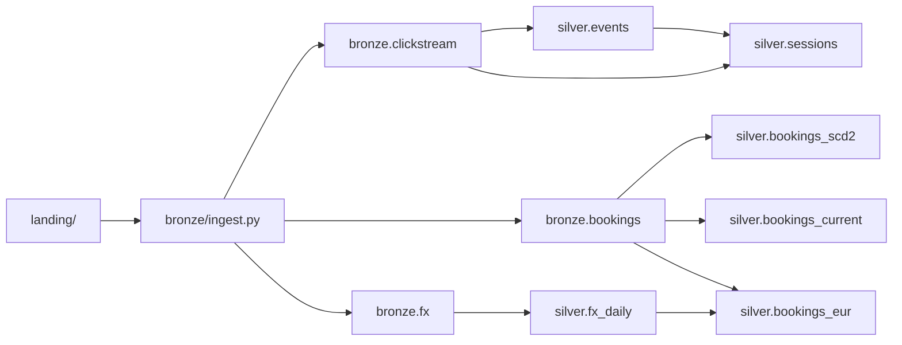

# Research — gold-dbt (Fase 4)

**Tarea:** documentar lo que existe hoy para construir Gold con dbt sobre Athena: staging, modelo dimensional, atribución en tres modelos, ROAS, funnel, RFM, tests, contratos, exposures y docs; "hecho cuando el glosario de KPIs coincide con el SQL" (`gold-dbt/context.md:8`).
**Alcance:** `spark/jobs/silver/`, `spark/jobs/bronze/ingest.py`, `generators/ota/`, `infra/terraform/modules/lakehouse/`, `infra/terraform/bootstrap/` (boundaries y roles de CI), `.github/workflows/`. Sin `contracts/` ni `dbt/` (no existen).
**Review:** 1 ronda adversarial (GO-WITH-FIXES), hallazgos 1-6 aplicados.
**Conventions aplicables (por nombre):** Compute split, Table format, Medallion layers, Idempotency, Apply gate, IaC only, No hourly-billed resources, Region.

## Summary

Silver tiene hoy seis tablas Iceberg escritas por Spark en `skyroute_<env>_silver`: `events`, `sessions`, `bookings_scd2`, `bookings_current`, `bookings_eur` y `fx_daily`. Bronze ingiere solo tres fuentes (`clickstream`, `bookings`, `fx`); las fuentes de gasto publicitario y CRM que describe el README de producto no existen en el código. No existe proyecto dbt, ni base Glue `gold`, ni prefijo S3 `gold/` en IAM, ni workflow de CI para dbt. El workgroup de Athena existe con corte de 100 MB por consulta y solo el rol `local-data` puede usarlo. Varios KPIs del glosario (ROAS, CAC, canal, destino preferido, funnel por ficha/checkout) piden datos que Silver no tiene.

## 1. Tablas Silver (lo que existe)

| Tabla | Fuente (job) | Columnas | Clave / escritura | Partición |
|-------|--------------|----------|-------------------|-----------|
| `events` | `spark/jobs/silver/events.py` (251 líneas) | event_id, event_type, event_ts, customer_id, session_id, campaign_id, currency, amount decimal(12,2), consent_ts, email_hmac, booking_id (`events.py:50-63`) | `event_id`; MERGE solo INSERT (`events.py:192-198`) | `days(event_ts)` (`events.py:64`) |
| `sessions` | `sessions.py` (337 líneas) | session_key, customer_id, session_start, session_end, session_start_date, n_events, converted, booking_id (`sessions.py:62-72`) | `session_key`; MERGE update/insert/delete sobre [D-4, D] (`sessions.py:238-253`) | ninguna en el DDL |
| `bookings_scd2` | `bookings_scd2.py` | booking_id, history_id, customer_id, session_id, campaign_id, status, currency, amount, created_at, updated_at, valid_from, valid_to, is_current, row_hash (`bookings_scd2.py:45-59`) | SCD2 por `booking_id` (MERGE en `:162` y `:171`) | ninguna en el DDL |
| `bookings_current` | `bookings_current.py` | booking_id, history_id, customer_id, session_id, campaign_id, status, currency, amount, created_at, updated_at, changed_at (`bookings_current.py:30-41`) | `booking_id`; MERGE (`:88`) | ninguna en el DDL |
| `bookings_eur` | `bookings_eur.py` | booking_id, history_id, changed_at, currency, amount, fx_rate_applied decimal(18,6), amount_eur decimal(12,2) (`bookings_eur.py:43-50`) | `booking_id`; actualiza solo si (changed_at, history_id) es posterior (`bookings_eur.py:9-12`) | ninguna en el DDL |
| `fx_daily` | `fx_daily.py` | fx_date, currency, rate_per_eur decimal(18,6), source_date (`fx_daily.py:38-42`) | (fx_date, currency) | `fx_date` (`fx_daily.py:44`) |

Hechos de comportamiento relevantes para Gold:

- `sessions.session_key` no es estable hasta D+4: el job reescribe D-4..D en cada ejecución (`REWRITE_DAYS = 4`, `sessions.py:58`) y el propio docstring dice que Gold debe recalcular esa ventana (`sessions.py:25-27`). Aplica la Convention "Idempotency".
- `sessions` no lleva `campaign_id`, `session_id` del generador ni tipos de evento: solo conteo y `converted`/`booking_id` (`sessions.py:157-180`).
- `events.session_id` (del generador) y `sessions.session_key` (sesionización Spark por inactividad de 30 min, `sessions.py:54`) son dos nociones de sesión distintas.
- `bookings_eur` usa el tipo del día de `created_at`; no se recalcula si `fx_daily` se corrige (`bookings_eur.py:18-20`).
- Todas las tablas usan `write.wap.enabled` y se publican con `run_wap` (p. ej. `events.py:220`, `sessions.py:308`).
- `events` sustituye el email por `email_hmac`; conserva `consent_ts` (`events.py:15-18`).

## 2. Fuentes y generador

- Bronze ingiere `SOURCES = ("clickstream", "bookings", "fx")` (`spark/jobs/bronze/ingest.py:27`). No hay gasto publicitario (Google Ads, Meta, Criteo) ni CRM emailing, que el README de producto lista como fuentes (`platform-blueprint/current/project/README.md:29-30`).
- Tipos de evento generados: `page_view`, `search`, `add_to_cart`, `consent` (`generators/ota/model.py:35-36`) más `purchase` por reserva (`generators/ota/clickstream.py:85`). No hay eventos de "ficha" ni "checkout".
- Campañas: ocho nombres en `CAMPAIGNS` (`model.py:29-32`), con id `CMP-nnnn` (`clickstream.py:64`). No hay atributo de canal (SEA, meta, social, afiliación) en ningún punto.
- Estados de reserva: `confirmed`, `pending`, `cancelled` (`model.py:34`).
- El generador calcula `route` (`model.py:81`, `:107`), pero `export_bookings.py:28-31` no lo exporta, y ninguna tabla Silver lo tiene.
- Volumen: 120 reservas/día y 20.000 clientes (`model.py:20-21`).

## 3. Catálogo, Athena e IAM

- Bases Glue creadas: `skyroute_<env>_{bronze,silver,ops}`; `gold` queda fuera a propósito: "lo crea la fase de dbt" (`infra/terraform/modules/lakehouse/glue_catalog.tf:2`, `:9`). Medallion layers fija el nombre `skyroute_<env>_gold`.
- Workgroup `skyroute-<env>` (`athena.tf:5-6`): configuración forzada, métricas CloudWatch, `bytes_scanned_cutoff_per_query = 104857600` (100 MB, `athena.tf:12-14`), resultados en `athena-results/` con SSE-S3 (`athena.tf:16-21`); lifecycle de 7 días en `modules/generator-landing/bucket.tf:92-98`.
- Rol `glue-job`: S3 sin `athena-results/` ni Athena (`iam.tf:17-21`, `:14-15`).
- Rol `local-data` (owner con MFA, sesión de 1 h, `iam.tf:185-212`): S3 lectura/escritura/borrado en `bronze`, `silver`, `athena-results`, `glue-temp` (`iam.tf:22-26`); Glue con lista explícita `GetDatabase`, `GetDatabases`, `GetTable`, `GetTables`, `GetTableVersion`, `GetTableVersions`, `GetPartition`, `GetPartitions`, `CreateTable`, `UpdateTable` sobre `skyroute_<env>_*` (`iam.tf:72-83`; recursos en `:52-56`, `:84`) y DeleteTable (`:111-116`); Athena Start/Stop/Get sobre el workgroup (`:117-128`). No tiene `glue:CreateDatabase`, `glue:DeleteDatabase` ni prefijo `gold/`.
- Boundary `workload-boundary-dev` (`bootstrap/workload_boundary_dev.tf`): PutObject/GetObject/DeleteObject sin `gold/` (`:13-54`); Glue con comodín `glue:Get*` más `CreateDatabase`, `CreateTable`, `UpdateTable` y `DeleteTable` (`:56-70`, `glue:Get*` en `:59`); Athena igual que `local-data` (`:72-82`). La de prod es simétrica (`workload_boundary_prod.tf:13-82`; `glue:Get*` en `:59`). Lo efectivo es la intersección: el boundary permitiría cualquier `glue:Get*` y `CreateDatabase`, pero el rol `local-data` solo concede la lista explícita anterior. Cambiarla exige re-aplicar `bootstrap/` por el owner (Apply gate).
- Roles de CI: `ci-apply-{dev,prod}` pueden crear/actualizar el workgroup (`bootstrap/ci_roles.tf:216-223`, `ci_apply_dev.tf:119-122`); el ARN de base contempla `gold` en el comentario (`ci_roles.tf:28`).

## 4. CI y herramientas

- Workflows existentes: `terraform-plan.yml`, `terraform-apply.yml`, `spark-tests.yml` (`.github/workflows/`). Ninguno ejecuta dbt (verificado por el executor).
- No existen `dbt/` ni `contracts/` (Glob). `requirements-dev.txt` no contiene dbt (verificado por el orquestador con `grep -n -i dbt requirements-dev.txt`, sin resultados).
- No existe `airflow/` (DAG `marketing_daily` del README sin código).

## 5. Datos que pide cada KPI y producto frente a Silver

| Producto / KPI (README:15-19) | Datos necesarios | ¿Silver lo tiene? |
|-------------------------------|------------------|-------------------|
| `mart_roas_daily`: ingresos atribuidos / gasto, netos de cancelación, EUR | ingresos EUR por reserva, estado, touchpoints con campaña, gasto por campaña/día | Ingresos EUR (`bookings_eur`), estado (`bookings_current`/`scd2`), campaña (`events.campaign_id`); **gasto: no existe** |
| ROAS "por canal" | canal de cada campaña | **No**: no hay canal |
| `mart_cac_monthly`: gasto / clientes con primera reserva confirmada | gasto mensual; primera reserva confirmada por cliente | Primera reserva: derivable de `bookings_scd2` (status, valid_from); **gasto: no** |
| `mart_funnel`: búsqueda → ficha → checkout → reserva por sesión; look-to-book | eventos por tipo y sesión | `search` y `purchase` sí; **ficha y checkout no existen** (hay `page_view`, `add_to_cart`); sesión: dos nociones (§1) |
| `mart_customer_rfm`: recencia, frecuencia, monto | reservas por cliente con fecha e importe EUR | Sí (`bookings_current` + `bookings_eur`) |
| RFM: booking window | fecha de viaje frente a fecha de reserva | **No**: no hay fecha de viaje |
| RFM: destino preferido | destino de cada reserva | **No** en Silver (`route` solo en el generador, §2) |
| RFM: consentimiento RGPD | consentimiento y bajas | `events.consent_ts` sí; bajas del CRM **no** (fuente inexistente) |
| `mart_attribution` last-click, linear, position-based 40/20/40 | recorrido ordenado de touchpoints con campaña previos a cada reserva, ventana | `events` con `event_ts`, `customer_id`, `campaign_id`, `booking_id` en `purchase`. Hechos: cada reserva recibe una sola `campaign_id` (`model.py:80,94`) y todos los eventos de su recorrido la heredan (`model.py:154`, `clickstream.py:89`); las sesiones de navegación llevan una campaña por sesión (`clickstream.py:46,64`); un mismo `customer_id` (`randint(1, 20000)`) puede tener campañas distintas en sesiones distintas, sorteadas al azar y sin relación con el recorrido de la reserva. Consecuencia: dentro del recorrido de una reserva, last-click, linear y 40/20/40 dan el mismo resultado (pregunta 10) |

## 6. Merge points y flujo

Las aristas salen de las lecturas `source =`/`spark.table` de cada job (`events.py:207`, `sessions.py:285-287`, `bookings_scd2.py:205`, `bookings_current.py:103`, `bookings_eur.py:120`, `fx_daily.py:95`). Gold no tiene aún ningún nodo.

## 7. Riesgos (hechos observados)

- Corte de 100 MB por consulta (`athena.tf:14`): `events` y `sessions` crecen con 182 días de histórico; `sessions` y las tres de bookings no están particionadas, así que una consulta las lee enteras. Volumen del generador (verificado por el executor en `generators/ota/clickstream.py`, `model.py`, `keys.py`): 96 slots al día; 25 a 45 eventos de navegación por slot (media 35) en sesiones de 2 a 5 eventos; 120 reservas al día con recorridos de 1 a 4 eventos más un `purchase`; 3 % de duplicados y 5 % de eventos tardíos (hasta 72 h). Total: unos 3.900 eventos al día (entre 3.400 y 4.400), unos 117.000 al mes. Tamaño real en S3: no comprobado (lo aporta el owner), con `aws s3 ls s3://<bucket-dev>/silver/ --recursive --summarize --region eu-west-3`.
- Gasto y canal inexistentes: ROAS y CAC no son calculables con Silver actual.
- `session_key` inestable hasta D+4 (`sessions.py:25-27`).
- IAM sin `gold/` en boundary ni en roles: escribir Gold exige cambiar `bootstrap/` (owner, Apply gate) y el módulo `lakehouse` (CI, IaC only).
- `local-data` tiene sesión de 1 h (`max_session_duration = 3600`, `iam.tf:192`), límite para un `dbt build` largo.
- La Convention "Compute split" restringe qué motor escribe cada capa; los datos que faltan en Silver (route, canal) no pueden venir de dbt en `silver/`. De dónde salen (Spark en Silver, el generador o Bronze) queda en la pregunta 5.

## 8. Preguntas abiertas para el owner

1. ¿El gasto publicitario (y el canal de cada campaña) entra en esta fase, con generador y Bronze/Silver nuevos en Spark, o ROAS y CAC quedan fuera de la Fase 4?
2. ¿La CRM emailing y las bajas de consentimiento entran en esta fase o el RFM usa solo `events.consent_ts`?
3. Funnel: ¿se acepta mapear "ficha" y "checkout" a `page_view`/`add_to_cart`, o el generador debe emitir eventos nuevos?
4. ¿Qué noción de sesión usa Gold: `events.session_id` o `sessions.session_key`?
5. Destino preferido y booking window: ¿se añaden `route` y fecha de viaje (en el generador, en Bronze o en Silver con Spark) o se retiran del RFM?
6. Ventana de atribución (días) y si los ingresos atribuidos excluyen `pending` además de `cancelled`.
7. Identidad que ejecuta dbt: ¿`local-data` ampliado, un rol nuevo, o CI con OIDC?
8. ¿dbt corre en CI contra dev (coste Athena) o solo compila/parsea?
9. ¿Gold se construye en prod en esta fase o solo en dev?
10. ¿El generador debe producir recorridos con varias campañas antes de la reserva, para que los tres modelos de atribución se distingan?

## Inventario

| Archivo | Componente | Rol |
|---------|-----------|-----|
| `spark/jobs/silver/events.py` | Silver | Tabla `events` |
| `spark/jobs/silver/sessions.py` | Silver | Tabla `sessions` |
| `spark/jobs/silver/bookings_scd2.py`, `bookings_current.py`, `bookings_eur.py` | Silver | Tablas de reservas |
| `spark/jobs/silver/fx_daily.py` | Silver | Tipos de cambio |
| `spark/checks/*.yaml` | Silver | Checks WAP |
| `spark/jobs/bronze/ingest.py` | Bronze | Fuentes ingeridas |
| `generators/ota/model.py`, `clickstream.py`, `export_bookings.py` | Generador | Catálogos, eventos, exportación |
| `infra/terraform/modules/lakehouse/glue_catalog.tf`, `athena.tf`, `iam.tf` | Infra | Bases, workgroup, roles |
| `infra/terraform/modules/generator-landing/bucket.tf` | Infra | Lifecycle de `athena-results/` |
| `infra/terraform/bootstrap/workload_boundary_{dev,prod}.tf`, `ci_roles.tf`, `ci_apply_{dev,prod}.tf` | Bootstrap | Boundaries y permisos de CI |
| `.github/workflows/*.yml` | CI | Sin dbt |
| `docs/design/platform-blueprint/current/project/README.md` | Diseño | Glosario de KPIs |
